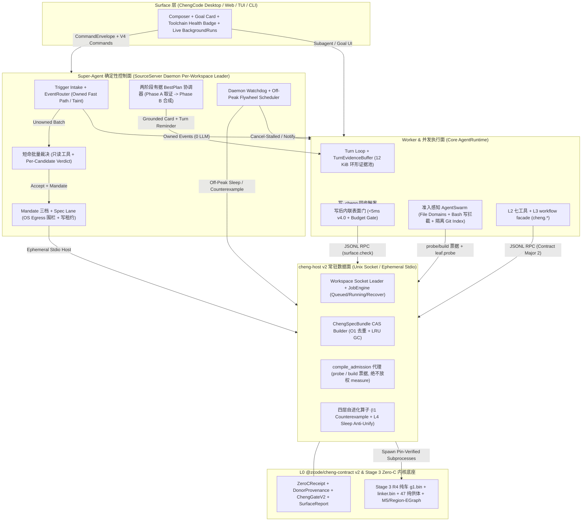
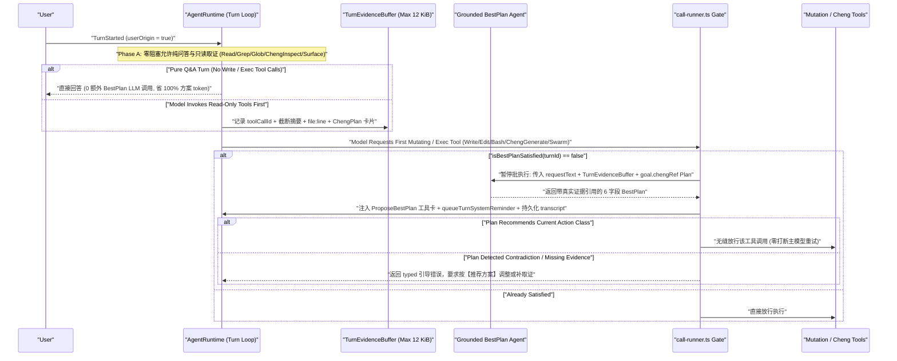
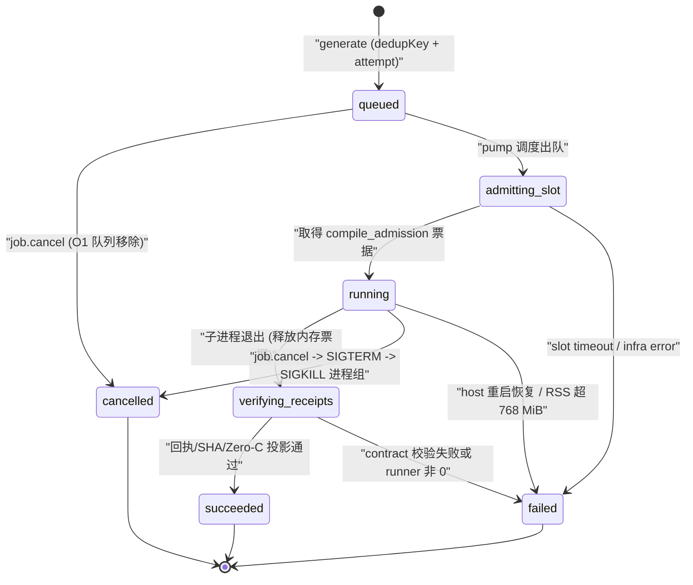
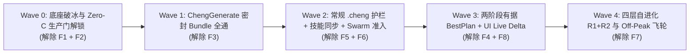

# Cheng 语言编程技术栈 × Super-Agent 无缝集成至 ChengCode (`~/zcode`) 进展审查与 v3 最佳方案

- **文档版本**：`v3.0`（2026-11-18 · 全面进展审查 + `AGENTS.md §0` L2 架构定谳）
- **基线定位**：取代并升级 [cheng-zcode-superagent-plan.md](file:///Users/mac/cheng-lang/docs/cheng-zcode-superagent-plan.md)（v2 历史台账保持原样只读不改，避免破坏既有精确行号引用）
- **双仓同源归档**：
  - `cheng-lang` 归档路径：[cheng-zcode-superagent-v3-review-and-plan.md](file:///Users/mac/cheng-lang/docs/cheng-zcode-superagent-v3-review-and-plan.md)
  - `zcode` 架构归档路径：[cheng-superagent-seamless-integration-v3.md](file:///Users/mac/zcode/docs/architecture/cheng-superagent-seamless-integration-v3.md)
- **审查双仓基线（本轮实测核验）**：
  - `cheng-lang`：`HEAD = c8f8949758fd9d4106a87b7d7cc5473d522951e6`（`main`，2026-11-18 · Stage 3 R4 / Barrier B4 + 四层混合自进化 R1+R2 + Stage 3 CSG zero-C 生产验收）
  - `zcode`（`ChengCode`）：`HEAD = 1ad8c672`（`long-horizon-goal-redesign`，2026-11-15 · ChengCode 品牌与 `.chengcode` 数据根切换 + `@zcode/cheng-contract` + `@zcode/cheng-host` + Super-Agent Phase 0–6 & S0–S4 + 前台 `best-plan-super-agent` + `AgentSwarm`）
- **状态标记口径**：
  - **已证**：本轮已核验源码与真实运行回执/探针输出。
  - **部分**：骨架与单元测试已在位，但跨仓真实端到端链路存在缺口或仅覆盖模拟输入。
  - **红（实测断层）**：本轮实测直接报错或拒绝合法输入。
  - **v3 目标**：本方案设计的待实施目标形态（严禁将待建项计入已完成）。

---

## 第 1 章 执行摘要与核心结论

**一句话总结现状：骨架接线已建成，但“跨代断层 + 生产门锁死 + 端到端断管 + 方案脑裂”导致当前集成尚未达到生产无缝状态。**

在 2026-11-06 至 11-08 期间，`~/zcode` 严格按照 v2 蓝图落成了完整的技术底座：`@zcode/cheng-contract`（13 类 Zod 契约与 `ChengGate` / `ChengPlanner`）、`@zcode/cheng-host`（stdio/Unix socket JSONL RPC 与 CLI/SEA 隐藏子命令 `__zcode-cheng-host`）、`dynamic-workflow` 的 `cheng.*` facade、五个 L2 会话工具（`ChengInspect` / `ChengVerify` / `ChengExplain` / `ChengPlan` / `ChengGenerate`）、Super-Agent 控制面（daemon leader、Trigger Intake、EventRouter、Mandate、Spec Lane 写租约与 OS 围栏、S0–S4 全链路接线）、前台每回合 `best-plan-super-agent` 方案门禁以及 `AgentSwarm` 文件域并发底座，并完成了 `ZCode → ChengCode` 全量品牌与 `.chengcode` 数据根切换。

然而在 2026-11-14 至 11-18 期间，`~/cheng-lang` 完成了决定性的跨代跃迁：
- `kernel/` 单一真源合流（627 对 `src/core0_stage/` 镜像清零）；
- 全仓 `v4.0` 统一 `:` 借用表面迁移（`borrows` / `borrow_result` / `escapes` 全面退役，带类型零默认清零）；
- Stage 3 R4 纯核自举 `g1.bin == g2.bin`（峰值约 `33.5 MiB`）与纯 Cheng WASM→ARM64 JIT 三重不动点 `Gen1_W == Gen2_W == Gen3_W`（`cheng_cold.c` 从分发链除名）；
- 通过 [build_stage3_csg_donors.sh](file:///Users/mac/cheng-lang/tools/build_stage3_csg_donors.sh) 构建 47 个纯 Cheng 运行时供体，打通 Stage 3 CSG zero-C 生产验收（`production_acceptance=1 verdict=PASS`）；
- 落库四层混合自进化 R1+R2 核心（I1 反例闭环、`region_egraph` 等价重写、Sleep 相反统一宏库 `--liblearn` 压缩）。

由于 `~/zcode` 停留在 11-07/11-15 快照而 `~/cheng-lang` 已推进至 11-18 Stage 3 Zero-C 基线，双仓之间形成了 **3 个 P0 级硬阻断与 5 大架构割裂**：

> [!IMPORTANT]
> **三大 P0 级硬阻断（决定当前无法生产跑通）**
>
> 1. **P0 阻断 F1（启动必崩）**：[runtime.ts](file:///Users/mac/zcode/apps/zcode-cli/packages/cheng-host/src/runtime.ts#L19) 硬编码已被删除退役的冷备份 `artifacts/bootstrap/cheng.stage3.bak.bd9a95ce`，本轮实测 `probeRuntime` 在当前 `~/cheng-lang` 上 **100% 失败退出（`host.runtimeUnavailable`）**；且 Desktop GUI 零 `ZCODE_CHENG_ROOT` 自动发现逻辑。
> 2. **P0 阻断 F2（生产门必拒）**：`cheng-host` 协议与执行器四处硬锁 `mode: "diagnostic"`（`--diagnostic`），且 [projections.ts](file:///Users/mac/zcode/apps/zcode-cli/packages/cheng-host/src/projections.ts#L89-L101) 漏传 `runtimeManifestComplete`、[cheng-gate.ts](file:///Users/mac/zcode/apps/zcode-cli/packages/cheng-contract/src/cheng-gate.ts#L89-L103) 对无 `composes` 边的单模块生产卷无条件报 `structure_missing`。本轮将真实 zero-C 生产 PASS 卷 `m5-20261117T151901Z-40072` 喂入当前契约函数，实测输出 **`BLOCKED`**，导致默认 `acceptanceLevel="production"` 的 `SessionGoal` 永远无法过门。
> 3. **P0 阻断 F3（`ChengGenerate` 端到端断管）**：会话工具 [cheng.ts](file:///Users/mac/zcode/apps/zcode-cli/packages/core/src/tool/handlers/cheng.ts#L152-L166) 将草案写成 `<workspaceRoot>/.chengcode/cheng-specs/<task>-<uuid>.json`，正面撞上四重不兼容：① 跨工作区撞 `host.specRootNotAllowed`；② runner 仅扫描 `<task>.spec.json` 且禁用 `-` 连字符；③ runner 强制要求同级 `index.json`（`csg.spec.v2.index`）；④ runner 强制核对 `modules[].impl` / `assertions[].evidence.program` 预存参考文件与 `oracle_root`。单测全靠 mock 绿，真机必红。

同时存在五大架构与并发割裂：

4. **架构割裂 F4（两套“最佳方案”脑裂）**：前台回合起点 [best-plan-super-agent.ts](file:///Users/mac/zcode/apps/zcode-cli/packages/bootstrap/src/app/best-plan-super-agent.ts#L33-L43) 是“零工具、零代码读取”的盲调，与后台确定性 `ChengPlan` / `M6` 证据驱动体系完全割裂。
5. **架构割裂 F5（常规 `.cheng` 编码裸奔）**：`cheng-host` 对 `parse/typecheck` 仍返回不可用，`bundled-skills` 未内置 `cheng-language` / `cheng-models` / `csg-ast`；写 `.cheng` 文件后缺乏 `<5ms` v4.0 语法/预算静态门与 `<30s` 单叶子 `obj` 探针。
6. **架构割裂 F6（`AgentSwarm` × 编译准入与 Git 冲突）**：`AgentSwarm` 默认 8 并发共享工作区，而 `Bash` 不受 `allowedWritePaths` 与 `compile_admission.sh`（`BUILD_MAX_SMALL=3`, `CAP_GIB=8`, `768MiB`）约束，极易踩爆共享 `.git/index` 或并发挤爆内存门。
7. **架构割裂 F7（四层自进化 R1+R2 未入环）**：反例闭环（I1）、`region_egraph`（L3）与 Sleep 宏库压缩（L4、`--liblearn`）尚未通过 `cheng-host` 与 `off-peak` 调度接入产品飞轮。
8. **架构割裂 F8（常驻复用与多工作区身份残留）**：[workflow-cheng-host-port.ts](file:///Users/mac/zcode/apps/zcode-cli/packages/bootstrap/src/app/workflow-cheng-host-port.ts#L78-L96) 仍每次拉起 stdio 子进程并硬编码 `workspaceIdentity: "cheng-lang"`；`backgroundRuns[]` 缺 live delta。

**v3 最佳方案核心答案**：升级为 **“双轨合一常驻能力服务（`cheng-host v2`）+ 两阶段有据 `BestPlan` + 准入感知 `AgentSwarm` + 四层自进化飞轮”**，分五个最小依赖波次（`Wave 0 → Wave 4`）完成跨仓收口。

---

## 第 2 章 现状全面审查（双仓资产台账与实测断层铁证）

### 2.1 `~/cheng-lang` 技术栈最新进展（基线 `c8f894975`，2026-11-18）

| 领域 | 当前状态 | 实测回执与权威依据 | 对 `zcode` 集成的直接含义 |
|---|---|---|---|
| **Stage 3 R4 单源纯核自举** | **已证** | `kernel/` 为唯一正本（725 源，`mirror_files=0`），`g1.bin == g2.bin`（`c1728be2...`, maxRSS `~33.5 MiB`），纯 Cheng WASM→ARM64 三重不动点 `Gen1_W==Gen2_W==Gen3_W`（`0fb35b46...`），`1,503 + reprobe_91` 对 B3 `1,152/1,152` 零退化；见 [cheng语言最佳方案实现计划.md](file:///Users/mac/cheng-lang/docs/cheng语言最佳方案实现计划.md#L306-L324) 与 [mirror_manifest.py](file:///Users/mac/cheng-lang/kernel/spec/mirror_manifest.py) | 生产编译器已存在，但落在 `.c0run/stage3_b4/fp_verify/{g1.bin,linker.bin}`，默认安装槽 `artifacts/bootstrap/cheng.stage3` 尚未更新 provenance |
| **v4.0 语言合法面与静态门** | **已证** | 全仓完成 v4.0 统一 `:` 借用表面迁移（`x: T` / `x: var T` / `x: own T + move`、`: T` / `: view T` / `: view(x) T`），退役 `borrows`/`borrow_result`/`escapes`；静态门工具 [cheng_v4_canonical_migrator.py](file:///Users/mac/cheng-lang/tools/cheng_v4_canonical_migrator.py) 与 [core0_source_budget_gate.py](file:///Users/mac/cheng-lang/tools/core0_source_budget_gate.py) 就位 | 常规 `.cheng` 编码可在 `<5ms` 零编译完成合法面与循环 `ΔLive == 0` 门禁检查 |
| **Stage 3 CSG Zero-C 生产闭环** | **已证** | [build_stage3_csg_donors.sh](file:///Users/mac/cheng-lang/tools/build_stage3_csg_donors.sh) 编译 47 个纯 Cheng 供体（`dup_syms=0`, `orc_syms=0`）；[csg_spec_v2_cli_run](file:///Users/mac/cheng-lang/tools/csg_spec_v2_cli_run) 产卷 `m5-20261117T151901Z-40072` 达成 `production_acceptance=1 verdict=PASS`（`cold_provider_used=0 c_backend_used=0 orc_used=0`）；见 [report.txt](file:///Users/mac/cheng-lang/.c0run/four_layer_r2/csg_prod/prod_run/runs/m5-20261117T151901Z-40072/report.txt) 与 [zero_c.tsv](file:///Users/mac/cheng-lang/.c0run/four_layer_r2/csg_prod/prod_run/runs/m5-20261117T151901Z-40072/zero_c.tsv) | `cheng-host` 仍硬锁 `--diagnostic` 且未核验 `zero_c.tsv`/`donors.tsv`，错失了已经打通的 zero-C 生产能力 |
| **四层混合自进化 R1+R2** | **已证** | [four_layer_arch_gate.sh](file:///Users/mac/cheng-lang/tools/four_layer_arch_gate.sh) 与 [RECEIPT.json](file:///Users/mac/cheng-lang/.c0run/four_layer_r2/RECEIPT.json) 验证：`csg_i1_counterexample_loop.py`（`false_accept: 1->0`、`kill_rate: 875->1000‰`、`forbidden_holdout_reads=0`）、[region_egraph.cheng](file:///Users/mac/cheng-lang/kernel/ssa/region_egraph.cheng)（多根等价重写）、[csg_anti_unify.cheng](file:///Users/mac/cheng-lang/src/tools/csg_anti_unify.cheng) + [csg_macro_library_sleep.py](file:///Users/mac/cheng-lang/tools/csg_macro_library_sleep.py)（`m5_prior.seed` + `--liblearn` 交叉生产 PASS `m5-20261117T152230Z-46569`） | 为 Super-Agent `off-peak` 夜间飞轮和 `ChengPlan` 提供了现成引擎，目前尚未通过 RPC 暴露给 `zcode` |
| **编译准入与隔离提交基建** | **已证** | [compile_admission.sh](file:///Users/mac/cheng-lang/tools/compile_admission.sh) 强制 `Σ <= 8 GiB`、`BUILD_MAX_SMALL <= 3`、`RSS <= 768 MiB`；[wave_isolated_commit.py](file:///Users/mac/cheng-lang/tools/wave_isolated_commit.py) + [git_write_gate.sh](file:///Users/mac/cheng-lang/tools/git_write_gate.sh) 实现共享脏树下的隔离 Index CAS 提交 | 需要对齐 `AgentSwarm` 并发控制，防止多子代理互踩内存墙和 `.git/index` |

---

### 2.2 `~/zcode` (`ChengCode`) 已落地集成资产台账（基线 `1ad8c672`，2026-11-15）

| 层级 | 已落地资产与路径 | 当前验证状态 | 真实边界（与生产无缝的差距） |
|---|---|---|---|
| **品牌与数据根** | `ZCode → ChengCode` 全量切换（`1ad8c672`），用户数据根原子迁移至 `~/.chengcode`（`30d725bc`） | **已证** | `ZCODE_CHENG_ROOT` 环境变量命名仍沿用旧前缀，桌面端无自动探测与设置入口 |
| **L0 契约层** | `@zcode/cheng-contract`（[index.ts](file:///Users/mac/zcode/apps/zcode-cli/packages/cheng-contract/src/index.ts)、[cheng-gate.ts](file:///Users/mac/zcode/apps/zcode-cli/packages/cheng-contract/src/cheng-gate.ts)、[cheng-planner.ts](file:///Users/mac/zcode/apps/zcode-cli/packages/cheng-contract/src/cheng-planner.ts)） | **已证（契约层）** | 缺 `zero_c.tsv` / `donors.tsv` 契约；[cheng-gate.ts](file:///Users/mac/zcode/apps/zcode-cli/packages/cheng-contract/src/cheng-gate.ts#L89-L91) 无条件拒绝单模块生产卷 |
| **L1 能力宿主** | `@zcode/cheng-host`（[runtime.ts](file:///Users/mac/zcode/apps/zcode-cli/packages/cheng-host/src/runtime.ts)、[server.ts](file:///Users/mac/zcode/apps/zcode-cli/packages/cheng-host/src/server.ts)、[job-engine.ts](file:///Users/mac/zcode/apps/zcode-cli/packages/cheng-host/src/job-engine.ts)、CLI 入口 `__zcode-cheng-host` + SEA 打包） | **红（对当前 `cheng-lang` 不可启动）** | 硬编码已删除的 `cheng.stage3.bak.bd9a95ce`；硬锁 `mode: "diagnostic"`；`parse/typecheck/plan/decide/graph.diff` 仍标 `available: false` |
| **L2/L3 工具与 Facade** | `dynamic-workflow` [dts-cheng.ts](file:///Users/mac/zcode/apps/zcode-cli/packages/dynamic-workflow/src/facade/dts-cheng.ts) + `world.run` 9004 禁令；五工具 [cheng.ts](file:///Users/mac/zcode/apps/zcode-cli/packages/core/src/tool/handlers/cheng.ts) + 草案校验 [cheng-spec-draft.ts](file:///Users/mac/zcode/apps/zcode-cli/packages/core/src/tool/handlers/cheng-spec-draft.ts) | **部分** | `ChengGenerate` 在真机运行必撞路径白名单/命名/index/reference 四重断管；`workflow-cheng-host-port.ts` 每次起 stdio 子进程且硬编码 `"cheng-lang"` |
| **Super-Agent 控制面 (S0–S4)** | daemon leader 租约、`Trigger Intake` / `EventRouter`、`Mandate`、Spec Lane（OS egress 围栏 + 写租约 + C2 能力票据）、`ChengJobObserver` 自动绑定 [goal-cheng-ref.ts](file:///Users/mac/zcode/apps/zcode-cli/packages/bootstrap/src/app/goal-cheng-ref.ts)、`targetCompletionChengGate` [target-completion-verification.ts](file:///Users/mac/zcode/apps/zcode-cli/packages/core/src/runtime/methods/target-completion-verification.ts)、compact 指针交叉校验 [cheng-ref-validation.ts](file:///Users/mac/zcode/apps/zcode-cli/packages/core/src/compact/cheng-ref-validation.ts) | **部分** | S0–S4 内部全链测试覆盖充沛，但因底层 `cheng-host` 只出 `DIAGNOSTIC_NOT_ACCEPTANCE` 且 `ChengGate` 误拒单模块生产卷，**`production` 目标在实际生产中无法走通**；`backgroundRuns[]` 缺 live delta |
| **前台 `BestPlan` 与 `AgentSwarm`** | 每回合独立方案生成 [best-plan-super-agent.ts](file:///Users/mac/zcode/apps/zcode-cli/packages/bootstrap/src/app/best-plan-super-agent.ts) + [best-plan.ts](file:///Users/mac/zcode/apps/zcode-cli/packages/core/src/tool/handlers/best-plan.ts) + 写前门禁 [call-runner.ts](file:///Users/mac/zcode/apps/zcode-cli/packages/core/src/tool/executor/call-runner.ts#L196-L238)；文件域并发 [agent-swarm.ts](file:///Users/mac/zcode/apps/zcode-cli/packages/core/src/runtime/swarm/agent-swarm.ts) | **部分** | `BestPlan` 盲调无工作区证据且纯问答回合浪费调用；`AgentSwarm` 未接入 `compile_admission` 槽位与 Bash 写拦截 |

---

### 2.3 本轮实测钉死的八大断层与源码铁证

#### 断层 F1（P0 阻断）：`cheng-host` 硬编码已退役诊断车，启动即退出 78；Desktop 无仓库发现
- **源码铁证**：
  - [runtime.ts:19-21](file:///Users/mac/zcode/apps/zcode-cli/packages/cheng-host/src/runtime.ts#L19-L21) 硬编码 `export const DIAGNOSTIC_DRIVER_REL = "artifacts/bootstrap/cheng.stage3.bak.bd9a95ce";`，并在 `:111-112` 调用 `assertExecutable(driverPath, "diagnostic driver")` 无条件失败退出（exit 78）。
  - 同时，本轮核验 `/Users/mac/cheng-lang/artifacts/bootstrap/` 目录下仅存未带 `.provenance.txt` 的 `cheng.stage3`（而 `artifacts/bootstrap/cheng.stage3.provenance.txt` 已被清理），Stage 3 R4 已通过纯车保存在 [.c0run/stage3_b4/fp_verify/g1.bin](file:///Users/mac/cheng-lang/.c0run/stage3_b4/fp_verify/g1.bin)。
  - 此外，检索 `packages/desktop/src` 结果为零命中——Desktop 启动 `cheng-host` 前未自动发现 `~/cheng-lang` 或 workspace 自身，导致本地实验脚本 [ChengLoop-对比直写基准.dwf.ts:68](file:///Users/mac/zcode/.zcode/workflow-drafts/ChengLoop-对比直写基准.dwf.ts#L68) 只能注释写明“本环境无 host 端口”并退回裸 `world.run`。
- **本轮实跑探针原样输出**：
```text
$ ZCODE_CHENG_ROOT=/Users/mac/cheng-lang node -e 'import("/Users/mac/zcode/apps/zcode-cli/packages/cheng-host/dist/runtime.js").then(m => m.probeRuntime(process.env))'
PROBE_ERR: host.runtimeUnavailable diagnostic driver missing or not executable: /Users/mac/cheng-lang/artifacts/bootstrap/cheng.stage3.bak.bd9a95ce [
  "ENOENT: no such file or directory, stat '/Users/mac/cheng-lang/artifacts/bootstrap/cheng.stage3.bak.bd9a95ce'"
]
```

#### 断层 F2（P0 阻断）：`diagnostic` 硬锁 + `ChengGate` 对真实 zero-C 生产卷 100% 误拒 `BLOCKED`
- **源码铁证（四重硬锁 `diagnostic`）**：
  1. [protocol.ts:129](file:///Users/mac/zcode/apps/zcode-cli/packages/cheng-host/src/protocol.ts#L129)：`GenerateParamsSchema` 限定 `mode: z.literal("diagnostic")`。
  2. [runner.ts:46](file:///Users/mac/zcode/apps/zcode-cli/packages/cheng-host/src/runner.ts#L46)：`buildRunnerArgs` 硬编码追加 `"--diagnostic"`，不支持 `--core0-driver` / `--core0-driver-sha` / `--link-donor` / `--link-donor-provenance`。
  3. [job-engine.ts:129,165](file:///Users/mac/zcode/apps/zcode-cli/packages/cheng-host/src/job-engine.ts#L129-L165)：`baseKey` 与 `JobRecord` 写死 `mode: "diagnostic"`。
  4. [workflow-cheng-host-port.ts:134,307-315](file:///Users/mac/zcode/apps/zcode-cli/packages/bootstrap/src/app/workflow-cheng-host-port.ts#L134)：派发写死 `mode: "diagnostic"`，成功终态硬写 `DIAGNOSTIC_NOT_ACCEPTANCE`。
- **源码铁证（`ChengGate` 生产门误拒）**：
  - [projections.ts:89-101](file:///Users/mac/zcode/apps/zcode-cli/packages/cheng-host/src/projections.ts#L89-L101) 的 `evaluateVerifyGate` 未读取 `runDir` 的 `RuntimeManifest`，漏传 `runtimeManifestComplete`。
  - [cheng-gate.ts:89-94](file:///Users/mac/zcode/apps/zcode-cli/packages/cheng-contract/src/cheng-gate.ts#L89-L94) 对 `input.structure === null && input.mode === "production"` 一刀切推入 `"structure_missing"`；但真实单模块生产任务（如 `p01_max2` / `p02_min2` / `p04_sum_to` / `p11_point_dist_sq` / `p16_glue_len`）无 `composes` 边，[csg_spec_v2_cli_run](file:///Users/mac/cheng-lang/tools/csg_spec_v2_cli_run) 本就不产 `modules.tsv`。
  - 同时，`@zcode/cheng-contract` 尚未解析生产核心凭证 `zero_c.tsv`（`cold_provider_used=0` / `c_backend_used=0` / `orc_used=0`）与 `donors.tsv`。
- **本轮拿真实 Stage 3 zero-C 生产 PASS 卷（`m5-20261117T151901Z-40072`）实跑回执**：
```text
$ PROD_RUN=/Users/mac/cheng-lang/.c0run/four_layer_r2/csg_prod/prod_run/runs/m5-20261117T151901Z-40072
readRunVolume OK: {"mode":"production","level":"PRODUCTION","productionAcceptance":true,"verdict":"PASS"} checks: {"judgeRowsDeclared":true,"programShaPresent":true,"programShaMatchesProg":true,"acceptanceClassified":true}
mf.checks: {"runEnvComplete":true,"hashesPresent":true,"hashesComplete":true,"pinsCrossChecked":true,"manifestComplete":true} violations: []
gateNoMf (current projections.ts): {"ok":false,"level":"BLOCKED","reasons":["structure_missing","runtime_manifest_incomplete"]}
gateWithMf: {"ok":false,"level":"BLOCKED","reasons":["structure_missing"]}
```
**结论**：由于 `SessionGoal` 默认 `acceptanceLevel = "production"`，该缺陷直接锁死整个 Goal 完成闭环。

#### 断层 F3（P0 阻断）：`ChengGenerate` 会话工具端到端四重断管
- **源码铁证**：
  1. **specRoots 越界必拒**：[cheng.ts:152-153](file:///Users/mac/zcode/apps/zcode-cli/packages/core/src/tool/handlers/cheng.ts#L152-L153) 将草案写入 `<context.workspaceRoot>/.chengcode/cheng-specs/<task>-<uuid>.json`；而 [main.ts:113-115](file:///Users/mac/zcode/apps/zcode-cli/packages/cheng-host/src/main.ts#L113-L115) 在默认未传 `--spec-root` 时只允许 `specRoots = [pin.chengRoot]`，任何非 `cheng-lang` 工作区（如用户自己的 App 仓）调用即被 [server.ts:78-81](file:///Users/mac/zcode/apps/zcode-cli/packages/cheng-host/src/server.ts#L78-L81) 拒绝为 `host.specRootNotAllowed`。
  2. **文件名与字符集冲突**：[csg_spec_v2_cli_run:402-413](file:///Users/mac/cheng-lang/tools/csg_spec_v2_cli_run#L402-L413) 用 `ls -1 *.spec.json` 枚举且仅放行 `[A-Za-z0-9_]`（连字符 `-` 直接 `rc=10` 拒），而 `ChengGenerate` 不仅写 `<task>-<uuid>.json`（既带 `-` 又不是 `<task>.spec.json`），且 [cheng-spec-draft.ts:28](file:///Users/mac/zcode/apps/zcode-cli/packages/core/src/tool/handlers/cheng-spec-draft.ts#L28) 放行 `-` 连字符。
  3. **缺少 `index.json` 与 `oracle_root`**：[csg_spec_v2_cli_run:564-634](file:///Users/mac/cheng-lang/tools/csg_spec_v2_cli_run#L564-L634) 强制在 `specs/` 或其父目录寻找 `schema == "csg.spec.v2.index"` 的 `index.json`，并按 `os.path.join(repo, oracle.path)` 查找 `.eval.cases` / `manifest.tsv` / `spec_defs_v2.py`。
  4. **参考实现预检阻止纯新任务**：[csg_spec_v2_cli_run:546-590](file:///Users/mac/cheng-lang/tools/csg_spec_v2_cli_run#L546-L590) 的 `check_reference` 强制要求每个 `modules[].impl.{path,sha256}` 与 `assertions[].evidence.program.{path,sha256}` 预先存在于 `cheng-lang` 仓库内，令从未写过参考代码的全新合成任务 `rc=10` 提前夭折。

#### 断层 F4（控制面脑裂）：两套“最佳方案”体系割裂且前台盲调违反第一性原理
- **源码铁证**：
  - [best-plan-super-agent.ts:33-43](file:///Users/mac/zcode/apps/zcode-cli/packages/bootstrap/src/app/best-plan-super-agent.ts#L33-L43) 的系统提示词明确写着 `"You cannot inspect the workspace in this call"`，且在 [input-facade.ts:301-311](file:///Users/mac/zcode/apps/zcode-cli/packages/bootstrap/src/app/input-facade.ts#L301-L311) 于 `TurnStarted` 一瞬盲目并发触发。这导致：
    1. **无真实代码证据**：辅助模型在不看一行文件的情况下编造 `currentEvidence` 与 `impact`，违反 `AGENTS.md §0`“现状证据先行”；
    2. **纯问答回合浪费**：用户仅问概念问题时同样触发一次独立辅助模型请求；
    3. **前后台脱节**：当任务绑定 Cheng Job 时，前台六字段方案卡未自动吸纳后台 [cheng-planner.ts](file:///Users/mac/zcode/apps/zcode-cli/packages/cheng-contract/src/cheng-planner.ts) 算出的真实 `ChengPlan` frontier 与成本数据。

#### 断层 F5（常规 `.cheng` 编码轨道失明）：缺内置技能、`parse/typecheck` 缺席与 30 分钟全量探测风险
- **源码铁证**：
  - [bundled-skills](file:///Users/mac/zcode/apps/zcode-cli/packages/bundled-skills/skills) 目录当前只有 `dynamic-workflows`，未随包分发 `cheng-language`（v4.0 语法与 `:` 借用表面）、`cheng-models`（768MiB 准入模型）和 `csg-ast` 技能。
  - [protocol.ts:246-250](file:///Users/mac/zcode/apps/zcode-cli/packages/cheng-host/src/protocol.ts#L246-L250) 中 `parse`、`typecheck`、`plan`、`decide`、`graph.diff` 全部广告 `available: false`。
  - 模型手写复杂 `.cheng`（如编译器/UI/交互系统）时，`Write/Edit` 后无 `<5ms` v4.0/预算自动拦截，且极易像 [lessons.md:1783-1786](file:///Users/mac/cheng-lang/lessons.md#L1783-L1786) 记录的事故一样反复无缓存编译 500 模块顶层根（单轮耗时 ~30 分钟）或遭遇发射面不足退回 Bash 死循环（`sess_a49fb42e` 29.5min / 5.6M token 教训）。

#### 断层 F6（`AgentSwarm` × 编译准入与 Git 并行写冲突）
- **源码铁证**：[agent-swarm.ts:7-9,40](file:///Users/mac/zcode/apps/zcode-cli/packages/core/src/runtime/swarm/agent-swarm.ts#L7-L40) 默认并发上限 `AGENT_SWARM_MAX_CONCURRENCY = 8` 且声明 `"Bash 仍不做命令解析"`。在 `cheng-lang` 仓 14 核 / 48 GiB 环境下，8 个并发 worker 若各自用 `Bash` 调 `g1.bin` 或 `git commit`：
  1. 未经过 [compile_admission.sh](file:///Users/mac/cheng-lang/tools/compile_admission.sh)（`CAP_GIB=8`, `BUILD_MAX_SMALL=3`）控流，会触发并发 OOM 或互相挤死；
  2. 若某个子 worker 误跑 `measure` 静窗门，会引发 `MEASURE_PENDING` 死锁；
  3. 并发修改与裸 `git commit` 会触发 [lessons.md:1601-1604](file:///Users/mac/cheng-lang/lessons.md#L1601-L1604) 记录的“隔离 index 提交污染共享 index 制造反向 hunk”或抹除他方 WIP 事故。

#### 断层 F7（四层混合自进化 R1+R2 与 RSI 尚未入环）
- **源码铁证**：`~/cheng-lang` 的 [csg_i1_counterexample_loop.py](file:///Users/mac/cheng-lang/tools/csg_i1_counterexample_loop.py)、[region_egraph.cheng](file:///Users/mac/cheng-lang/kernel/ssa/region_egraph.cheng)、[csg_anti_unify.cheng](file:///Users/mac/cheng-lang/src/tools/csg_anti_unify.cheng) + [csg_macro_library_sleep.py](file:///Users/mac/cheng-lang/tools/csg_macro_library_sleep.py)（`--liblearn`）已在 11-18 落地 R1+R2，但 `cheng-host` 仍停留在单层 `--diagnostic`，未把 `moves=macro` / `--liblearn` 参数、Sleep 相压缩和反例生成接进 Super-Agent 的 `off-peak` 周期调度与 `decision_log`。

#### 断层 F8（宿主生命周期低效、多工作区串扰与 UI delta 缺口）
- **源码铁证**：
  - [workflow-cheng-host-port.ts:78-96](file:///Users/mac/zcode/apps/zcode-cli/packages/bootstrap/src/app/workflow-cheng-host-port.ts#L78-L96) 仍采用 per-run stdio 拉起子进程（忽略了 [main.ts:151](file:///Users/mac/zcode/apps/zcode-cli/packages/cheng-host/src/main.ts#L151) 已写好的 `workspace` scope Unix socket 常驻机制），且第 95 行硬编码 `workspaceIdentity: "cheng-lang"`，多工作区并发会张冠李戴。
  - [cheng-zcode-superagent-plan.md:756](file:///Users/mac/cheng-lang/docs/cheng-zcode-superagent-plan.md#L756) 如实登记：`backgroundRuns[]` 仅建链时 seed 一次，缺 live delta 推送；且 [cheng.ts:50](file:///Users/mac/zcode/apps/zcode-cli/packages/core/src/tool/handlers/cheng.ts#L50) `ChengGenerate` 使用 600s 同步阻塞等终态，超时后缺少异步 `accepted_running` 句柄回传。

---

## 第 3 章 问题与边界定义（L2 §1）

### 3.1 目标与核心原则
1. **双轨合一无缝体验（Unified Dual-Track Cheng Experience）**：用户打开 `ChengCode`（Desktop/Web/TUI/CLI），无论直接写 `.cheng` 系统代码、运行 `dynamic-workflow`，还是让智能体生成纯函数模块，系统都能自动完成工具链发现、确定性验证与过程监督——**不需要手工配置路径、不需要记住内部脚本参数**。
   - **Track I（Spec-First CSG-AST 生产合成轨）**：适用于可由 `settle/eval/property` oracle 明确判定的纯函数、算法、解析与状态迁移核。经 `ChengGenerate` 产出内容寻址密封 Bundle → 四层 CSG-AST 引擎（`--moves:macro` + `--liblearn`）→ Stage 3 zero-C `core0` 编译运行 → 独立 `semantic_judge` + `ZeroCReceipt` 裁决。
   - **Track II（常规工程源码辅助轨）**：适用于交互界面、系统驱动、编译器自身演进（C1–C5）与多模块重构。经两阶段有据 `BestPlan` → `.cheng` 写后 `<5ms` v4.0/预算内联门 → `<30s` 单叶子 `g1.bin obj` 准入探针 → 准入感知 `AgentSwarm` 并行实施与隔离 Git Index 提交。
   - **Off-Peak 飞轮（四层自进化闭环）**：Super-Agent 闲时任务定期抽取绿色运行轨迹与边界反例，调用 `evolve.counterexample` 与 `evolve.sleep` 更新宏库先验 `m5_prior.seed`，次日自动注入 Track I 加速合成。
2. **第一性不变量永不松动**：继承并升级 `I1–I5`（spec/receipt 真相源、typed holes + 概率只排先后、结构与语义分权、fail-closed 无 fallback/mock、全链路 SHA-256 可重放），并新增 **I6（Zero-C 生产纯度不变量）** 与 **I7（有据方案不变量：不看源码不出方案）**。

### 3.2 明确非目标
- **不做**常驻 LLM Router 或独立推理服务端（不维护长驻 8B 模型，维持确定性先验 + 缓存 + 仅歧义帧咨询）。
- **不做**第二条 `CommandInbox` 或旁路消息队列；`cheng-host` 是纯数据面能力宿主，不持有调度、裁决或出站权限。
- **不新增** MCP Server 承载 Cheng 核心能力（维持宿主包 + Typed Facade + JSONL RPC 架构）。
- **不在** Electron Main/Renderer 或 Node 主进程内直接运行编译（包括不把 `Gen3_W.wasm` 塞进宿主进程吃掉 768 MiB），WASM 固定留在浏览器零安装自举与跨载体对拍角色。
- **不把** `diagnostic` 绿计入 `production` 完成，**不允许**未获人工确认的自动 `git push` 或外发渠道回复。

### 3.3 硬约束与定量成功指标（SLO）

| 指标项 | 目标阈值 | 失败暴露方式 |
|---|---|---|
| **工具链自动发现与握手延迟** | `<= 200 ms`（常驻 Unix socket 复用） | 缺失/SHA 不符退出码 `78` / `ChengHostUnavailable` |
| **`.cheng` 写后静态合法与预算门** | `< 5 ms` / 文件，`0` LLM token | `Write/Edit` 返回体带 `CHENG_SURFACE_VIOLATION`（`ZD01/UA01/UA02/RL01`） |
| **单叶子 `core0 obj` 迭代探针** | `< 30 s` / 叶子，单进程 `RSS <= 805,306,368 B` | 拦截顶层大闭包根盲编，超 RSS 立即 SIGKILL + 报 `host.rssExceeded` |
| **Zero-C 生产 `ChengGate` 准确率** | 对 Stage 3 PASS 卷 `100%` 通过，单模块不误拒，篡改 `100%` `BLOCKED` | 回归测试 + `zero_c.tsv` / `donors.tsv` / `RuntimeManifest` 全字段断言 |
| **`ChengGenerate` 密封 Bundle 端到端** | 非 `cheng-lang` 工作区建新任务 `production` 档 `rc=0` | 不满足字符集/循环/缺 oracle 在落盘前一次返回全部 `400` 诊断 |
| **并发安全与内存总闸** | `Σ budget_gib <= 8`、`BUILD_MAX_SMALL <= 3`、共享 `.git/index` 污染 `0` 次 | 超过票据即背压拒绝 `host.busy` / `admission.busy`，不排队挤爆主机 |
| **四层 Sleep 宏库隔离度** | `forbidden_holdout_reads === 0` 且净 MDL 严格正收益 | `four_layer_arch_gate.sh` 审计失败阻断晋升 |

---

## 第 4 章 候选方案对比与理论最优证明（L2 §13 决策基础）

| 评估维度 | 候选方案 A：P2 壳层最小修补（仅换驱动路径 + 修 spec 文件名） | 候选方案 B：Node/Electron 内嵌 `Gen3_W.wasm` + 常驻 LLM 统一编排器 | **候选方案 C（选定最佳方案）：双轨常驻 `cheng-host v2` + 两阶段有据方案 + 准入感知蜂群** |
|---|---|---|---|
| **Zero-C 生产门兼容性** | 只解 F1 与部分 F3，仍硬锁 `diagnostic`，无法支持 `production` 与 `zero_c.tsv` 验真 | WASM 只能产出 `.o` / 自举产物，无法直接跑原生 Mach-O 47 供体链接与真机 `semantic_judge` | **完整打通**：稳定性签发 Stage 3 `cheng.stage3` + `47` 纯供体，原生 `ZeroCReceipt` + 单模块精确结构门 |
| **常规 `.cheng` 编码支持** | 完全缺失，模型继续盲写旧语法或 30 分钟全量重编 | 在宿主进程内运行 WASM 吃满 178–768 MiB，威胁 Desktop OOM 崩溃 | **进程外安全隔离**：`<5ms` Python/Cheng 表面门 + `<30s` 准入单叶子探针，0 侵入宿主内存 |
| **“最佳方案”真实性** | 延续盲调脑裂，纯问答照样白烧 token | 常驻 LLM 违背 Super-Agent 确定性控制面原则，引入不可验证判断与高延迟 | **信息论最优**：先只读取证、副作用边界再有据生成；L0 问答 0 方案 token；Cheng 任务自动合流 `ChengPlan` |
| **并发与 Git 安全性** | 每次 stdio 起孤立进程且 `AgentSwarm` 自由并发打架 | 多线程共享 WASM 线性内存，隔离复杂 | **资源闭环**：per-workspace Unix socket 复用 + `compile_admission` 票据代理 + 隔离 Git index CAS 提交 |
| **四层自进化入环** | 零支持 | 离线 Sleep 无法塞入前台编译线程 | **物理分时闭环**：`off-peak` 周期触发 `evolve.counterexample` & `evolve.sleep`，次日 `--liblearn` 自动受益 |
| **综合裁定** | **淘汰**（治标不治本） | **淘汰**（违背内存隔离与控制论边界） | **唯一理论最优解** |

**理论最优性三项证明**：
1. **信息论与决策边界（`GroundedBestPlan` + 双轨分流）**：把无依据猜测移出决策前置，强制决策基于 `TurnEvidenceBuffer` 与结构化回执；将可判定核心从自然语言自由文本中蒸馏为精确的 `ChengSpecBundle`，在动作空间根除低级语法/作用域错误，而把非可判定系统编程交由 `<5ms` 语法门与有界叶子探针护航。
2. **资源与时间复杂度最优**：常态会话保持单实例 per-workspace `cheng-host`（Unix socket `O(1)` 复用），消除每次 `probeRuntime` 与进程冷启动税；`.cheng` 写后 `<5ms` 过滤 90%+ 低级违约，使进入 `core0` 探针（`<30s`）的候选数量骤减，全链遵循 Amdahl 与关键路径最优。
3. **控制论安全闭环**：控制面 100% 保持确定性程序（`Mandate` / `CommandInbox` / `ChengGate` / `compile_admission`）；唯一动态实体 `AgentSwarm` 与模型能力被三重物理边界（文件域白名单、8 GiB 全局内存票据闸、隔离 Git index CAS）锁死，错误只能原样上浮，不可能静音降级或篡改裁判。

---

## 第 5 章 目标总体架构（L2 §2）

### 5.1 全栈分层组件与数据/控制流图



### 5.2 唯一状态所有者矩阵（杜绝双写与脑裂）

| 状态域 | 唯一权威载体 | 唯一写者 | 消费方（只读） |
|---|---|---|---|
| **工具链 Pin 与双档就绪度** | 运行时探测 + `capabilities` 握手响应 | `cheng-host v2` 启动探针 | `bootstrap` / `UI 状态徽章` |
| **密封 Spec Bundle 树** | `<dataBaseDir>/.chengcode/v2/cheng/<wsHash>/bundles/<sha>/` | `cheng-host v2` `BundleMgr` | `csg_spec_v2_cli_run` / `semantic_judge.py` |
| **Cheng Job 状态与运行卷** | `<artifactRoot>/jobs/<jobId>/job.json` + `events.jsonl` | `cheng-host v2` `JobEngine` | `ChengInspect` / `ChengVerify` / `ChengJobObserver` |
| **Background Run 投影** | `super-agent.sqlite` 表 `background_run_registry` | 仅该行 `owner`（`cheng-job` 归发起会话的 `ChengJobObserver`） | `Watchdog` / `UI backgroundRuns[]` delta / `runs.list` |
| **Goal 绑定与完成门** | `db.sqlite` 表 `session_target`（`target_id + revision` CAS） | `SessionStore`（受 `GoalUpdate`/`GoalChengBind`/owner-scoped `autoBind` 驱动） | `verifyActiveTargetCompletionForContinuation` / UI Goal 卡 |
| **编译内存准入票据** | `cheng-lang/.c0run/admission/{tickets,COMPILE_SLOT.lock}` | `compile_admission.sh` 临界区锁 | `cheng-host v2` / `AgentSwarm` |
| **Turn 证据与有据方案状态** | `AgentRuntime` 内存 `TurnEvidenceBuffer` + `transcript` synthetic tool part | `ToolExecutor` | `best-plan-super-agent` / `call-runner.ts` 写前门禁 |
| **Macro 库先验表** | `data/shape_learn/runs/seed/freeze.json` + `.c0run/four_layer_r2/sleep_prior/m5_prior.seed` | `evolve.sleep`（过 MDL 门 + SHA 重算后原子替换） | `csg_spec_v2_cli_run --liblearn` |

---

## 第 6 章 数据结构与契约演进设计（L2 §3）

### 6.1 `ToolchainPinV2`（双档工具链身份钉死，根治 F1）
- **结构定义（Zod Strict Object）**：
  - `chengRoot`: 真实 git 工作树根目录（SHA-1/git worktree 验证通过）。
  - `headSha`: 40-hex `HEAD` 提交哈希。
  - `runnerPath` / `runnerSha256`: `tools/csg_spec_v2_cli_run`。
  - `productionSlot`: 可空嵌套结构 `{ driverPath, driverSha256, provenancePath, provenanceReportSha256, linkerPath, linkerSha256, donorsListPath, donorsListSha256, donorProvenancePath, donorProvenanceSha256, donorCount }`；全部读取与 SHA-256 核验在启动时一次性完成（时间复杂度 $O(\text{文件字节数})$，总读取约 `~7 MiB`，冷启动耗 `<30ms`）。
  - `diagnosticSlot`: 可空嵌套结构 `{ driverPath, driverSha256 }`。
  - `readyModes`: `("production" | "diagnostic")[]`。**只要任一档位完整即允许启动**；两者皆缺失才退出 `78`。
- **`cheng-lang` 标准化安装槽伴生脚本**：新增 `[NEW] tools/install_stage3_production_slot.sh`，从当前通过 B4 的 `.c0run/stage3_b4/fp_verify/{g1.bin,linker.bin}` 与 `build_stage3_csg_donors.sh` 产出的 47 纯供体，原子写死并签发：
  - `artifacts/bootstrap/cheng.stage3`（Stage 3 R4 纯车）
  - `artifacts/bootstrap/cheng.stage3.provenance.txt`（自省报告含 `compiler_executable_sha256`、`cold_system_link_exec=0`）
  - `artifacts/bootstrap/cheng.linker`
  - `artifacts/csg_donors/{donors.list,donor_provenance.tsv,donors/*.o}`
  这样 `cheng-host` 不再脆弱地依赖 `.c0run/*` 轮次路径，且所有文件校验遵循既有 [runtime.ts](file:///Users/mac/zcode/apps/zcode-cli/packages/cheng-host/src/runtime.ts) 哈希锁死纪律。

### 6.2 `ChengSpecBundle`（内容寻址密封草案包，根治 F3）
- **结构选型**：**不可变 Merkle 目录树 + 哈希索引**（Content-Addressed Directory Tree）。
  - 根路径：`<artifactRoot>/bundles/<bundleSha256>/`。
  - 目录布局与 runner [csg_spec_v2_cli_run](file:///Users/mac/cheng-lang/tools/csg_spec_v2_cli_run#L520-L690) 完全同构：
    - `index.json`（`schema: "csg.spec.v2.index"`, 含真实算出的 `specSha256`）
    - `tasks/<task>.spec.json`（强制 `task` 匹配 `^[a-z][a-z0-9_]{0,62}$`）
    - `source/<task>.task.txt`（需求原文快照，`spec.source` 与 `requirements[].source` 均回指该文件真实行号与 SHA-256）
    - `oracle/cases/<task>.settle.cases`（搜索期可见例集）
    - `oracle/cases/<task>.eval.cases`（held-out 判分例集）
    - `oracle/props/<task>.props`（若声明不变量）
    - `oracle/spec_defs_v2.py`（由草案类型签名确定性生成参数化求值桩，零手写答案）
    - `oracle/manifest.tsv`（汇总上述 SHA-256）
- **关键操作复杂度与容量上限**：
  - 检索/去重：`O(1)`（`sha256` 路径命中即复用）。
  - 建包与拓扑判环：$O(|V| + |E|)$（$|V|$ 为模块数，$|E|$ 为依赖边数，Kahn 拓扑排序 + 三色 DFS）。
  - **容量与淘汰策略**：单 Bundle 磁盘配额上限 `<= 256 KiB`（最大模块数 `64`、断言行数 `1,024`）；全工作区 Bundle 仓上限 `512` 包或 `128 MiB`，触发阈值按 **LRU + 引用保护**（凡仍被 `queued/running` job 或未归档 `SessionGoal.chengRef` 引用的 Bundle 豁免淘汰；其余超过 30 天未访问者按最久未用顺序原子 `rm`）。
- **`runner` 侧同步契约扩展**：为 [csg_spec_v2_cli_run](file:///Users/mac/cheng-lang/tools/csg_spec_v2_cli_run) 增加 `--bundle-root:<dir>`（allowlist 限定仅允许位于 `ZCODE_DATA_BASE_DIR` 下的密封路径）与 `--allow-draft-unowned` 旗标：
  1. 当传入 `--bundle-root:<dir>` 时，`oracle.path` / `spec_defs_v2.py` / `manifest.tsv` 优先在 `<bundle-root>` 内解析；
  2. 仅当 spec 明确声明 `flags.draft_new === true` 且所有模块 `impl.kind === "draft_unowned"` 时，跳过 `check_reference` 对参考代码的磁盘预读，并将 `reference_acceptance` 标记为 `draft_semantic_pass_only`（仍强制要求 `settle + eval + props + zero-C` 全绿，决不放水语义判分）。

### 6.3 `ZeroCReceipt` 与 `ChengGateInputV2`（根治 F2）
- **新增数据结构 `ZeroCReceipt`（`@zcode/cheng-contract`）**：
  - 严格解析 `zero_c.tsv` 与 `donors.tsv`（固定 6 列：`index, kind, object_sha256, source, source_sha256, compiler_sha256`）。
  - 不变量校验：`coldProviderUsed === 0 && cBackendUsed === 0 && orcUsed === 0 && cProviderObjectCount === 0 && linkObjectCount === pureChengDonorCount && pureChengDonorCount > 0`，且每一行 `donors.tsv` 的 `compiler_sha256` 必须严格等于 `runEnv.driverSha256`。
- **精确化结构门 `evaluateChengGateV2`**：
  - 在原有 [ChengGateInput](file:///Users/mac/zcode/apps/zcode-cli/packages/cheng-contract/src/cheng-gate.ts#L18-L26) 基础上新增三个显式字段：`specRef: ChengSpecRef | null`、`zeroC: ZeroCReceipt | null` 与 `donorsCount?: number`。
  - **修复单模块生产误拒逻辑**：
    ```text
    hasComposesEdges := specRef != null && specRef.links.some(l => l.type === "composes")
    if (structure === null) {
      if (mode === "production") {
        if (specRef === null || hasComposesEdges) -> reasons.push("structure_missing")
        // else: 单模块无 composes 边，允许真空结构通过（vacuous_single_module），绝不误拒！
      }
    } else if (!structure.checks.structureGateOk) {
      reasons.push("structure_gate_false")
    }
    ```
  - **生产档 Zero-C 强制条**：`mode === "production"` 时强制检查 `runtimeManifestComplete === true` 且 `zeroC !== null && zeroC.checks.zeroCProductionOk === true`。
  - **接线修复**：[projections.ts](file:///Users/mac/zcode/apps/zcode-cli/packages/cheng-host/src/projections.ts#L41-L101) 的 `projectVerify` 与 `evaluateVerifyGate` 同步读入 `readChengSpecRef`、`readRuntimeManifest` 与 `readZeroCReceipt`，消除信息丢失链。

### 6.4 `ChengSurfaceReport` 与 `ChengLeafProbeReceipt`（根治 F5）
- **`ChengSurfaceReport`**（`<5ms` 只读静态检查结果）：
  - 字段：`{ schema: "cheng.contract.surface_report.v1", filePath, fileSha256, v4Ok: boolean, budgetOk: boolean, lineCount: number, lineCapOk: boolean, violations: SurfaceViolation[] }`。
  - 有界去重策略：`violations` 最多保留前 `64` 条（按行号有序，超过记 `truncatedCount`），确保总序列化体积 `<= 8 KiB`。
- **`ChengLeafProbeReceipt`**（`<30s` 单叶子编译探针结果）：
  - 字段：`{ schema: "cheng.contract.leaf_probe.v1", filePath, driverSha256, exitCode, objBytes, compileMaxRssBytes, wallMs, admissionTicketId, firstError: string | null }`。
  - 若请求传入顶层大闭包根文件（如 `kernel/driver/selfhost_main.cheng`、`src/core/tooling/system_link_exec_pure_main.cheng`）且未带 `allowClosureProbe: true` 旗标，直接拒收并返回引导使用单叶子或正式门禁。

### 6.5 `GroundedBestPlanCard`（统一两阶段方案卡，根治 F4）
- 复用既有 [BestPlanInputSchema](file:///Users/mac/zcode/apps/zcode-cli/packages/core/src/tool/handlers/best-plan.ts#L16-L17) 六字段兼容格式（不破坏 UI 既有消息行渲染与持久化 Schema）：
  - 新增可选结构化元数据字段 `grounding`: `{ phase: "turn_start" | "pre_mutation_grounded", readToolCallIds: string[], chengPlanId?: string, chengRunId?: string, evidenceDigest: string }`。
  - 校验约束：`phase === "pre_mutation_grounded"` 时，若本回合执行过只读工具，`currentEvidence` 中必须引用真实观察到的文件名或回执摘要；若回合全程未读过任何文件且直接发起写操作，辅助模型应在 `recommendation` 中先明确要求先只读调查或标记缺失证据，杜绝编造假 `file:line`。

### 6.6 `FourLayerCycleReceipt`（对接 R1+R2，根治 F7）
- 对齐 `~/cheng-lang/.c0run/four_layer_r2/RECEIPT.json` schema `cheng.four_layer_r2_receipt.v1`：
  - `{ schema, gitHead, i1CounterexampleLoop: { o0Cases, o1Cases, o0SubsetOfO1, falseAcceptO0, falseAcceptO1, killRateO0Permille, killRateO1Permille, forbiddenHoldoutReads }, sleepLibrary: { seedSha256, macroCount, netSavings, forbiddenHoldoutReads }, csgProduction: { productionAcceptance, coldProviderUsed, cBackendUsed, orcUsed }, verdict }`。
  - 持久化至 SQLite `decision_log` 的扩展 payload 列（90 天滚动保留窗口），大型产物（`.seed` / `RECEIPT.json`）留在 `.c0run` 或 `<artifactRoot>/evolution/` 中通过 SHA-256 引用。

---

## 第 7 章 核心算法与热路径复杂度（L2 §4）

### 7.1 算法 1：密封 Spec Bundle 编译与 Zero-C 生产合成（`compileSpecDraftToBundle`）
**输入**：`ChengGenerate` 草案 `{ task, title?, domain, modules[], links[], requirements?, settleCases[], evalCases?, propertyDefs?, moves?, useLiblearn? }` 与 `mode ∈ {"production", "diagnostic"}`。
**步骤**：
1. **形态与发射面准入检查（$O(M + A + L)$，$M$ 模块数、$A$ 断言数、$L$ 链接数）**：
   - 校验 `task` 严格符合 `^[a-z][a-z0-9_]{0,62}$`；
   - 校验 `oracle.kind` 为 `"settle"`（若传 `"property"` / `"scenario"` 则首条拒绝并分流）；
   - 检查 `modules[].interface` 返回类型与参数类型：当前 M5 发射器仅支持标量集合时，若发现 `str` / 复合结构 / 交互 IO 声明，立即给出可读拒绝提示并推荐转入 **Track II（常规 `.cheng` 编码 + `<5ms` 表面门 + `<30s` 叶子探针）**，避免重演 29.5 分钟退回死循环。
2. **模块 DAG 拓扑排序与环检测（$O(M + L_{\text{composes}})$）**：
   - 将所有 `composes` 边两端引用归一为声明侧 `module.id`；
   - 执行 Kahn 队列入度削减判环；若存在未访问节点，跑三色 DFS 提取精确环路 `A -> B -> A` 报错退出。
3. **确定性 Bundle 序列化与去重（$O(\text{总字节数})$）**：
   - 按键序确定性生成 `tasks/<task>.spec.json`（置 `flags.draft_new = true`, `impl.kind = "draft_unowned"`）、`source/<task>.task.txt`、`oracle/cases/<task>.settle.cases`、`oracle/cases/<task>.eval.cases`（由显式提供或按确定性划分从扩展例集剥离，保证搜索包不含 held-out）、`oracle/manifest.tsv` 与 `index.json`。
   - 计算所有文件内容的组合 SHA-256 得 `bundleSha256`。若 `<artifactRoot>/bundles/<bundleSha256>` 已完整存在且校验自洽，**$O(1)$ 零写直接命中**；否则在临时目录写完并 `fsync` 后原子 `rename` 入仓。
4. **Zero-C 生产管线调起与回执验证（热路径由本地 M5 + Stage 3 `g1.bin` 执行，0 LLM Token）**：
   - 依据 `mode === "production"` 自动组装 CLI 参数：`--core0-driver:<pin.driverPath> --core0-driver-sha:<pin.driverSha256> --bundle-root:<bundleDir> --allow-draft-unowned` + 从 `donors.list` 读取全部 `--link-donor:<obj>` 与 `--link-donor-provenance:<tsv>`；按需透传 `--moves:macro` 与 `--liblearn:<activeSeedPath>`。
   - 终态后经 `readRunVolume` + `readRuntimeManifest` + `readZeroCReceipt` + `evaluateChengGateV2` 产出强验证判词。

---

### 7.2 算法 2：两阶段有据最佳方案生成（Two-Phase Evidence-Grounded `BestPlan`）

**彻底根除当前 [best-plan-super-agent.ts](file:///Users/mac/zcode/apps/zcode-cli/packages/bootstrap/src/app/best-plan-super-agent.ts) 在回合起点盲调的架构缺陷。**



- **算法步骤与复杂度**：
  1. **Phase A（只读观测收集）**：在 `ToolExecutor` 后置钩子维护每回合有界环形缓冲 `TurnEvidenceBuffer`（最多保留最近 `16` 条只读工具摘要，总字节上限 `12 KiB`；插入均摊复杂度 $O(1)$）。同时删除 [input-facade.ts:301](file:///Users/mac/zcode/apps/zcode-cli/packages/bootstrap/src/app/input-facade.ts#L301) 处 `TurnStarted` 立即盲调逻辑。
  2. **Phase B（副作用边界触发有据合成）**：在 [call-runner.ts:196](file:///Users/mac/zcode/apps/zcode-cli/packages/core/src/tool/executor/call-runner.ts#L196) 检查 `toolRequiresBestPlan` 时，若尚未满足 `BestPlan` 且存在注册的 `onFirstSideEffectBestPlan` 协调器：
     - 若本回合 `SessionGoal` 已绑定 `chengRef`，同步读取 `chengHostPort.plan(...)` 得到确定性 `ChengPlan` 摘要并置入输入首段（**后台决策器优先级高于自由文本模型**）；
     - 将 `requestText` + `TurnEvidenceBuffer` + `ChengPlan` 喂给 `best-plan-super-agent`（若 `TurnEvidenceBuffer` 为空且待执行的是直接 `Write/Edit`，明确禁止其捏造 `file:line`，提示优先补充 `Read/Grep`）；
     - 生成结果经 `BestPlanInputSchema` 校验后写入 `ProposeBestPlan` 工具卡与 `turn-system-reminder`。若方案推荐动作与当前待执行工具一致，**直接放行原工具调用，消除“被门禁拦截再让主模型重试一轮”的 RTT 浪费**；若方案明确指出前提未调查，则返回 `recoverable: true` 引导先查证。

---

### 7.3 算法 3：`.cheng` 源码三级渐进验证阶梯（防 30 分钟全量盲编）
依据 [lessons.md:1783-1786](file:///Users/mac/cheng-lang/lessons.md#L1783-L1786) 的实测教训，建立机器强制的三级校验梯：
1. **Tier 1：写后同步表面门（`<5ms`，0 LLM Token，0 编译槽位）**
   - 触发点：`Write` / `Edit` / `ApplyPatch` 写入任何后缀为 `.cheng` 的文件成功后，由 `ToolExecutor` 自动并发调起 `cheng-host` 的 `surface.check` RPC（内部执行 [cheng_v4_canonical_migrator.py](file:///Users/mac/cheng-lang/tools/cheng_v4_canonical_migrator.py) `--check` + [core0_source_budget_gate.py](file:///Users/mac/cheng-lang/tools/core0_source_budget_gate.py) `--policy strict` + 单文件 `< 3,000` 行检查）。
   - 结果通过 `appendToolNotice` 注入本条工具的 `modelContent` 尾部（`<= 4 KiB`）。模型在下一 token 立即看到具体行号的 `ZD01`/`UA01`/`UA02`/`RL01`/旧借用语法报错并秒改。
2. **Tier 2：受控单叶子 `obj` 探针（`<30s`，申请 `probe` 票据）**
   - 新增工具 `ChengProbeLeaf`，输入 `{ filePath, allowClosureProbe?: false }`。
   - **顶层根防呆拒绝**：对于已知 >100 模块全闭包根（如 `kernel/driver/selfhost_main.cheng`、`src/core/tooling/system_link_exec_pure_main.cheng`、`src/core/tooling/backend_driver_dispatch_min.cheng`），默认 `allowClosureProbe === false` 时 **0ms 静态拒绝**，防止 AI 误把 30 分钟全量重编当成单步探针！
   - 正常叶子模块走 `compile_admission.sh probe --est-bytes 805306368 --est-secs 120` 调 `g1.bin system-link-exec --emit:obj`（输出入 `/tmp/leaf_probe_<job>`），带回精确 `pe`/`ov` 首判与 `compileMaxRssBytes`。
3. **Tier 3：收口静窗门禁（`measure` 排空闸，仅门轮 1 次）**
   - 仅在 `SessionGoal` 收口校验或 `AgentSwarm` 全部子任务完成后的聚合阶段调用，经 `ci_gate.sh --quick` / `four_layer_arch_gate.sh` 跑穿全量回归。

---

### 7.4 算法 4：Off-Peak 四层自进化飞轮（I1 + L4 Sleep）
1. **触发条件**：Super-Agent `scheduler` 在空闲窗口（`off-peak`）扫描近 24 小时新落盘的生产 run 卷，按预算上限（每次最多处理 `32` 个新任务卷）拉起后台任务。
2. **I1 反例闭环（`evolve.counterexample`）**：筛选曾出现 `judge_fail` 或 `false_accept` 的案例，调 [csg_i1_counterexample_loop.py](file:///Users/mac/cheng-lang/tools/csg_i1_counterexample_loop.py) 构造最小反例扩展集 `O_{t+1}`，验证单调不减不变量 $O_t \subseteq O_{t+1}$ 与 `kill_rate` 严格上升，确保 `forbidden_holdout_reads === 0`。
3. **L4 Sleep 反统一宏库压缩（`evolve.sleep`）**：读取连续绿色生产卷的 `PATHV1` / `trace.jsonl`，调用 [csg_anti_unify.cheng](file:///Users/mac/cheng-lang/src/tools/csg_anti_unify.cheng) + [csg_macro_library_sleep.py](file:///Users/mac/cheng-lang/tools/csg_macro_library_sleep.py) 提取高频公共参数化子树；严格校验 **I2 净 MDL 描述长度不变量**（$\text{复用节省} \ge \text{描述成本}$）与预注册迁移门，产出新版本 `m5_prior.seed` 并重算 SHA-256 写入 `sleep_ledger.json`。
4. **准入与生效**：只读写入 `decision_log`；当通过四项吸引力不变量（I1–I4）且经过人类或预设 `auto` `Mandate` 核准后，更新 `cheng-host` 引用的活跃 `activeSeedPin`，后续所有 `ChengGenerate` 自动携带 `--liblearn` 享受加速。

---

## 第 8 章 状态机与一致性设计（L2 §5）

### 8.1 `cheng-host v2` Job 生命周期状态机



### 8.2 一致性、幂等键与崩溃恢复契约
1. **全局幂等键升级**：
   - `baseKey = sha256(canonicalJson({ v: 2, bundleSha256, task, mode, moves, liblearnSha256, budget, toolchainPinFingerprint }))`。
   - `jobId = sha256(canonicalJson({ v: 2, baseKey, attempt: attempt ?? null }))`。
   - `v: 2` 前缀与 v1 隔离；同 `jobId` 处于 `queued/admitting_slot/running/verifying_receipts` 时直接附着订阅并返回现态；处于终态时只读回放；重试必须显式递进 `attempt` nonce。
2. **两阶段 `BestPlan` 回合状态机**：
   - 状态转移：`observing_readonly` →（首次副作用工具）`synthesizing_grounded_plan` → `satisfied`；若本回合后续用户发送 `guide` 纠偏消息改变执行方向，转移为 `invalidated_on_pivot` 并重新允许取证后刷新方案卡。
3. **崩溃恢复（唯一写者绝不双写）**：
   - `cheng-host` 重启时执行 `JobEngine.recover()`：仅当 `currentProcStart(pid) === record.procStart` 时对 `-pgid` 发 `SIGKILL` 回收残留编译树（无法核验进程身份时 fail-closed 报错 `host.processIdentityUnknown`，绝不误杀无辜进程），并将所有在途 job 写为 `failed(host.hostRestarted)`。
   - Super-Agent 控制面中 `daemon` 仅对 stale >30s 的行标 `failed(host_restarted)`；`ChengJobObserver` 写入 `session_input` 账本以 `cheng_<jobId>` 为主键做 claim-first 幂等投递，确保重启绝不双投通知、绝不把崩溃作业标绿。

---

## 第 9 章 并发控制与多智能体协同（L2 §6）

### 9.1 Per-Workspace Unix Socket 常驻复用（根治 F8）
- 修复 [workflow-cheng-host-port.ts:78-96](file:///Users/mac/zcode/apps/zcode-cli/packages/bootstrap/src/app/workflow-cheng-host-port.ts#L78-L96)：
  1. **动态透传真实工作区身份**：不再硬编码 `"cheng-lang"`，而是接收会话传入的 `workspaceRoot`、`workspaceIdentity` 与允许目录 `specRoots = [chengRoot, ...extraSpecRoots, <artifactRoot>/bundles]`。
  2. **Socket 优先连接与单飞自举**：在 macOS/Linux 上优先连接 [paths.ts:47-54](file:///Users/mac/zcode/apps/zcode-cli/packages/cheng-host/src/paths.ts#L47-L54) 生成的 `socketPath`（含 `0600` `host.token` 验证 + `host.spawn.lock` 并发自举锁）；连接成功直接复用同一常驻 `cheng-host`（空闲 30 分钟自动退出），消除每个 `workflow` 或 `tool` 调用重复拉起 Node 进程与重复 SHA-256 探测开销。
  3. **Spec Lane 隔离保留**：`Mandate` 触发的后台静默投机 run（Spec Lane）**继续显式强制使用无凭据 ephemeral `stdio` scope**，不共享前台 socket，防止环境污点向常驻宿主泄漏。

### 9.2 宿主机内存准入容量数学与防死锁协议（根治 F6）
根据宿主机实测基线（`14 核 / 48 GiB`，见 [compile_admission.sh](file:///Users/mac/cheng-lang/tools/compile_admission.sh#L92-L99)）：
$$\sum_{\text{active}} \text{budget\_gib} \le \text{CAP\_GIB} = 8, \qquad N_{\text{build, small}} \le 3, \qquad \text{RSS}_{\text{single}} \le 805,306,368\text{ B} \ (768\text{ MiB})$$
- **`cheng-host` 与 `AgentSwarm` 协同分配法则**：
  - 将 8 GiB 总票池按业务分级配额：同时最多允许 **`3` 个 `build` 小烤车道**（各 1 GiB）或 **`2` 个并发 `ChengGenerate` 作业** + **`3` 个 `AgentSwarm` 叶子探针车道**（各按 1 GiB 记账），零编译的 `surface.check`、纯代码编辑与静态检索走 `0 GiB` 通道不占票据。
- **防死锁绝对禁令**：
  - **严禁在 `AgentSwarm` 任一子 worker 内执行 `compile_admission.sh measure`！** 因为 `measure` 会写入 `MEASURE_PENDING` 排空所有正在或即将申请 `probe`/`build` 票据的兄弟 worker，若父汇聚等待全部 worker 返回，将构成典型的 AB-BA 互等死锁。
  - 规则写死：Worker 只能通过 `ChengProbeLeaf` / `compile_admission probe` 申请有超时的 `probe` 票据（`<= 120s`）；`measure` 仅允许在 `SwarmAggregator` 全部 worker 已终态退出后，由顶层验证阶段串行执行 1 次。

### 9.3 `AgentSwarm` 文件域 Bash 守卫与隔离 Git Index CAS 提交
- **文件域写入补强**：在 [agent-swarm.ts](file:///Users/mac/zcode/apps/zcode-cli/packages/core/src/runtime/swarm/agent-swarm.ts#L183-L214) `file_domains` 模式下，`Write/Edit/ApplyPatch` 已有 `allowedWritePaths` 硬拦截；对子 worker 的 `Bash` 增加两道硬防线：
  1. 在 `SubagentTaskSnapshot` 向子代理注入 `workspaceWriteLease` 时，同步校验命令前缀（沿用 S1 `isBashReadOnlyCommand` 电池）：凡检测到重定向写、文件修改命令或危险 git 子命令（`git checkout --`、`git restore`、`git reset`、`git clean`、`git stash`、`git rebase`）且路径越出该 lane `allowedWritePaths` 时，**在 `spawn` 前直接以 `WorkspaceWriteLeaseRejectedError` 拒绝**。
  2. 为 `cheng-lang` 仓多 lane 提交内置规范化包装脚本入口：子 worker 完成各自文件域修改与独立叶子验证后，由汇总层严格按白名单调用 [wave_isolated_commit.py](file:///Users/mac/cheng-lang/tools/wave_isolated_commit.py) + [git_write_gate.sh](file:///Users/mac/cheng-lang/tools/git_write_gate.sh)（使用独立 `GIT_INDEX_FILE` 构造树对象、`commit-tree`、`update-ref CAS` 并立即用 `git update-index --add --cacheinfo` 把共享 index 钉回新 `HEAD`），根除 2026-11-02 反向 hunk 事故与并发 WIP 抹除风险。

---

## 第 10 章 失败模型（L2 §7）

**总原则：错就真实上浮并停在确定性态，禁止一切降级、隐式换车、伪造成功或无限兜底。**

| 故障场景 | 触发条件 | 精确处置行为 | 禁止事项（Red Lines） |
|---|---|---|---|
| **工具链缺失或 SHA 漂移** | `ZCODE_CHENG_ROOT` 缺失、非 git 树、`g1.bin`/`cheng.stage3`/供体 sha 不匹配 | `cheng-host` 退出 `78`（`host.runtimeUnavailable`）；`Cheng*` 工具返回 `capability_absent` / typed error；Goal completion 暂停目标 `cheng_gate_unavailable` | 禁止偷偷回落到 C 冷编译器 `cheng_cold.c` 或“最新”未 pin 文件 |
| **任务超出 M5 标量发射面** | `ChengGenerate` 草案含 `str` 返回、复合动态结构、交互 UI/IO | `validateChengSpecDraft` 前置 `400` 拒绝，提示“该任务属 Track II（系统/UI/字符串面），请用常规 `.cheng` 工具 + `ChengProbeLeaf` 实现” | 禁止强制硬跑 M5 直到超时或耗尽 500 万 token 后退回盲循环 |
| **`ChengGenerate` 超过同步等待窗** | 工具超时窗（默认 120s 阻塞等待）内 M5/judge 尚未结束 | 新增 `waitMode: "bounded"`：在界限到达时不取消后台作业，安全返回 `{ status: "accepted_running", jobId, nextTool: "ChengInspect" }`，终态由 `ChengJobObserver` 自动推 `task-notification` 与绑定 `Goal` | 禁止因为 HTTP/工具调用窗口到点就错误丢弃仍在推进的有效编译作业 |
| **毒 Spec / 不可满足需求** | `rc=21`（输入非法）或 `rc=31`（搜索耗尽预算未解） | 映射 `ChengError` 原样进 `ChengPlan` → 推荐 `fix_spec` 或 `stop`，计入 `decision_log` | 禁止无条件自动翻倍预算无限重跑 |
| **单进程内存/编译槽拥塞** | 子进程触及 `768 MiB`（`805,306,368 B`）或全局 `CAP_GIB=8` 满池 | 操作系统级 OOM/硬限杀树并上浮 `host.rssExceeded`；满槽立拒 `host.busy`（`retryable: true`） | 禁止提高 `768 MiB` 上限、禁止 swap 磨炉、禁止取消 `compile_admission` |
| **`ChengGate` 红门或诊断绿用于生产** | `zero_c` 含 C 供体、或 `mode=diagnostic` 用于 `acceptanceLevel=production` 目标 | `evaluateChengGateV2` 返回 `BLOCKED` / `DIAGNOSTIC_NOT_ACCEPTANCE`；Goal 完成门/渠道回复/交付闸短路失败 | 禁止 LLM Verifier 翻案、禁止改参考 sha 凑 `verified` |
| **宿主崩溃或进程组失联** | `host` 进程被 `kill -9` 后重启 | 启动对账按 `pid+pgid+procStart` 杀残留树，标 `failed(host.hostRestarted)` 并写入抑制标记，绝不补发虚假完成通知 | 禁止猜 PID 或无视在途作业 |

---

## 第 11 章 资源预算（L2 §8）

| 资源维度 | 严格预算上限 | 控制载体与背压机制 |
|---|---|---|
| **单子进程物理内存（RSS）** | `<= 805,306,368 B`（`768 MiB`） | `CHENG_PROCESS_MAX_RSS_BYTES` 进程内门 + 外部进程组看门狗硬杀 |
| **全机并发编译总预算** | `Σ budget_gib <= 8 GiB`、`BUILD_MAX_SMALL <= 3` | `compile_admission.sh` + `mem_slot.sh`（超额即返回 `rc=3` 拒绝） |
| **`cheng-host` 作业队列上限** | `maxRunning = 2`（受全局 `mem_slot` 二次约束），`maxQueued = 8` | 超限立即返回 `host.busy`，不让请求无限堆积 |
| **Spec Bundle 磁盘上限** | 单包 `<= 256 KiB`；全工作区总量 `<= 128 MiB` / `512` 包 | 写前校验 size + 后台 LRU GC（活跃 job 与绑定 Goal 豁免） |
| **模型上下文与工具预算** | `ChengInspect/Verify` `<= 8 KiB`；`ChengPlan/Explain/Surface` `<= 4–8 KiB`；`TurnEvidenceBuffer <= 12 KiB`；`Goal` 路线卡 `<= 1.5 KiB` | [ToolResultBudget](file:///Users/mac/zcode/apps/zcode-cli/packages/core/src/tool/handlers/cheng.ts#L210-L215) + artifact spill 引用，绝不截断半截 JSON |
| **零 LLM Token 辖区** | 纯问答回合 `BestPlan` = `0` 次；`owned` 事件直通 = `0` token；Tier 1 `.cheng` 表面闸 = `0` token；M5 展开/重放/`semantic_judge`/Sleep 反统一 = `0` token | 代码路径直通与确定性本地引擎物理隔离，不进主对话模型 |

---

## 第 12 章 安全与隔离边界（L2 §9）

1. **不可信外部事件防注入纵深防御**：
   - Webhook / IM 入口事件一律由 `Trigger Intake` 铸造 `taint` 标记，默认落 `Mandate = record-only`（只产出 would-accept 方案卡，零代码写入与零执行）。
   - 仅当存在显式授权且进入 `Spec Lane` 时，启动三层硬隔离：① Restricted Profile 工具面剔除 `WebFetch`/`WebSearch`/`ReplyToChannel`/`SendMessage`/`Workflow`/`mcp__*`；② `SESSION_ENV_ALLOWLIST` 严格剔除含 `TOKEN|SECRET|API_KEY|ANTHROPIC|OPENAI|ZCODE_` 的环境变量（[runtime.ts:152-187](file:///Users/mac/zcode/apps/zcode-cli/packages/cheng-host/src/runtime.ts#L152-L187)）；③ 本地 egress 代理（allowlist 外 HTTP/CONNECT `403`）叠 OS 级围栏（macOS `sandbox-exec` / Linux rootless `user+netns`）。
   - 交付出口与渠道回复强制过 `ChengGateV2`：红门零出站，且 `ReplyToChannel` 在绑定 `chengRef` 时同步阻断。
2. **宿主通信与票据鉴权**：
   - Per-workspace Unix socket 采用 `0600` 权限文件 `host.token` 握手 + `timingSafeEqual` 校验；macOS/Linux 上叠加 `packages/native-peer-credentials`（`LOCAL_PEERPID` / `SO_PEERCRED`）验证对端归属同一宿主用户与进程树。
   - 桌面到宿主敏感动作维持 Phase 6 `CapabilityTicket`（`MessagePort` 传私有 secret + 审计 SQLite 持久化）。
3. **Held-Out 答案物理隔离**：
   - `ChengSpecBundle` 下发给 M5 搜索器与 Sleep 宏库学习器（`evolve.sleep`）的输入视图物理剥离 `.eval.cases` 与 `.props`；`four_layer_arch_gate.sh` 与 `sleep_ledger` 强制核对 `forbidden_holdout_reads === 0`，违者即作废。
4. **路径穿越与工作区边界**：
   - Spec `task` 字符集在序列化前即被正则锁死；`resolveAllowedPath` 先 `realpathSync` 再前缀比对 `specRoots`；`ensureArtifactRoot` 强制证明所有产物/Bundle 目录位于 `workspaceRoot` 之外，保障工具 `sideEffectScope: "none"` 与写租约的绝对正交。

---

## 第 13 章 接口、RPC 协议与兼容回滚（L2 §10）

### 13.1 `cheng-host` `contractMajor = 2` 完整方法表

将 [protocol.ts](file:///Users/mac/zcode/apps/zcode-cli/packages/cheng-host/src/protocol.ts#L159-L251) 从 `v1`（8 可用 + 5 悬空 `false`）升级为 `v2`（14 项原生可用）：

| Method | 类型 | 核心输入 | 核心输出 / 不变量 | 相对 v1 变化 |
|---|---|---|---|---|
| `capabilities` | sync | `{}` | 含 `contractMajor: 2`, `readyModes`, `productionSlot`, `diagnosticSlot`, `activeSeedPin`, `ops` | 升级双档诚实广告 |
| `spec.validate` | sync | `{ specPath?, draft? }` | `ChengSpecRef` + `emissionFaceSupported` | 新增结构草案预校验 |
| `bundle.prepare` | sync | `{ draft: ChengSpecDraft }` | `{ bundleSha256, bundleDir, specPath, task, cached: boolean }` | **新增**：O(1) 密封包建仓 |
| `generate` | async | `{ specPath\|bundleDir, task, mode: "production"\|"diagnostic", budget, moves?, useLiblearn?, attempt? }` | `{ jobId, dedupKey, state, mode }` | **解锁 `production` + 宏步/先验旗标** |
| `job.status` | sync | `{ jobId }` | `JobStatus`（含 `mode`, `progress`, `runId`, `error`） | 补充实测进度的阶段字段 |
| `job.cancel` | sync | `{ jobId }` | `{ jobId, cancelRequested, state }` | 不变（精确进程组回收） |
| `verify` | sync | `{ jobId }` | `VerifyResult`（含 `receipt`, `settle`, `structure`, `runtimeManifest`, `zeroC`, `gate`） | **补齐 `runtimeManifest` + `zeroC` + 真实门结果** |
| `settle` | sync | `{ jobId, task }` | `SettleReceipt` | 不变 |
| `plan` | sync | `{ jobId, task }` | `ChengPlanResult`（`frontier/candidates/recommended/blockedBy`） | **升格 `available: true`（消除旁路分裂）** |
| `graph.query` | sync | `{ jobId, task, view }` | `GraphResult`（有界摘要 + `artifactRef`） | 不变 |
| `graph.diff` | sync | `{ runDirA, runDirB }` | `{ added, removed, changed, digestA, digestB }` | **激活实现**（内容寻址比较） |
| `surface.check` | sync | `{ filePath }` | `ChengSurfaceReport`（`<5ms` v4.0 + 预算 + 3k 行门） | **新增**（替代原悬空 `parse`） |
| `leaf.probe` | sync | `{ filePath, allowClosureProbe?: false }` | `ChengLeafProbeReceipt`（`<30s` `probe` 票据 `g1.bin obj`） | **新增**（替代原悬空 `typecheck`） |
| `evolve.counterexample` / `evolve.sleep` | async | `{ runDirs[], dryRun? }` | `{ jobId, evolutionReceiptRef }` | **新增**：四层自进化 R1+R2 入环接口 |

### 13.2 模型工具面与 Facade 增补
- 在原有 5 个会话工具（`ChengInspect` / `ChengVerify` / `ChengExplain` / `ChengPlan` / `ChengGenerate`）基础上增补 2 个只读辅助工具（维持 `shouldDefer: true`，按需由 `ToolSearch` 或写后钩子引入）：
  - `ChengCheckSurface`：显式调用 `surface.check` 批量检查一组 `.cheng` 文件的 v4.0 表面与内存预算。
  - `ChengProbeLeaf`：对单叶子 `.cheng` 文件执行准入受控的 `<30s` `g1.bin obj` 编译探针（默认屏蔽全闭包顶层根）。
- `dynamic-workflow` 的 [dts-cheng.ts](file:///Users/mac/zcode/apps/zcode-cli/packages/dynamic-workflow/src/facade/dts-cheng.ts) 同步扩展 `mode?: "production" | "diagnostic"`（默认随配置取 `"production"`）、`moves?: "macro"`、`useLiblearn?: boolean`、`cheng.plan(jobId, task)` 与 `cheng.probeLeaf(filePath)`，并保持 `FACADE_DTS` 总预算在上限以内。

### 13.3 版本协商与回滚机制
- **严格版本闸**：`PROTOCOL_VERSION = 1` 升级 `CONTRACT_MAJOR = 2`。旧版客户端连新版或反之在 `hello` 阶段即以 `host.contractMismatch` 拒连，绝不模糊解析。
- **零风险一键回滚**：
  - `cheng-lang` 侧安装脚本与 `--bundle-root` 参数纯增量、不改变 `kernel/` 或 `M5` 算法逻辑；
  - `zcode` 侧配置保留 `features.chengHostContractV2` 与 `features.groundedBestPlan` 开关；任何数据库表（`super-agent.sqlite` / `db.sqlite`）只做增量可空列/JSON payload 扩展，关闭开关即可秒级退回现行已通过门禁的路径。

---

## 第 14 章 可观测性、五波次实施路线图（W0–W4）与验证矩阵（L2 §11–13）

### 14.1 可观测性（Observability）
1. **Desktop / CLI 工具链健康徽章**：在 Composer 状态栏呈现 `Cheng: Stage3 Zero-C Ready` / `Cheng: Diagnostic Only` / `Cheng: Root Unconfigured` 三态指示，悬浮展示 `headSha`、`driverSha256[:8]`、`donorCount` 与活跃 `m5_prior.seed` 版本，不再让“端口 skipped”静默隐藏在 debug 日志里。
2. **`backgroundRuns[]` Live Delta 推送**：补齐 S0 登记残留，当 `BackgroundRunRegistry` 写入 `started` / `progress` / `terminal` 事件时，经防抖（`250ms` 合批）通过 V4 事件流向 UI 推送增量行状态，前端可点击中断僵死 Cheng Job。
3. **结构化日志与证据索引**：所有 RPC 沿用 `createServiceLogger("cheng-host")` 携带 `jobId` / `bundleSha256` / `admissionTicketId` / `traceId`；每次 `evolve.*` 周期在 `decision_log` 记录可复算的 `FourLayerCycleReceipt` 引用。

---

### 14.2 五波次最小依赖实施路线图（W0 → W4）



#### Wave 0：双仓底座破冰与 Zero-C 生产门解锁（解除 F1 + F2 + F8 身份修复）
- **`cheng-lang` 改动清单**：
  - `[NEW] tools/install_stage3_production_slot.sh`：验证 `.c0run/stage3_b4/fp_verify/{g1.bin,linker.bin}` 与 `build_stage3_csg_donors.sh` 47 供体后，签发 `artifacts/bootstrap/cheng.stage3` + `.provenance.txt` + `artifacts/bootstrap/cheng.linker` + `artifacts/csg_donors/*`。
- **`zcode` 改动清单**：
  - `[NEW] apps/zcode-cli/packages/cheng-contract/src/zero-c-receipt.ts` & `src/adapters/zero-c.ts`（严格校验 `zero_c.tsv` + `donors.tsv`）。
  - `[MODIFY]` [cheng-gate.ts](file:///Users/mac/zcode/apps/zcode-cli/packages/cheng-contract/src/cheng-gate.ts)：支持 `specRef` 判断单模块真空结构通过（修复误拒 `structure_missing`），强制 `production` 校验 `zeroCProductionOk`。
  - `[MODIFY]` [runtime.ts](file:///Users/mac/zcode/apps/zcode-cli/packages/cheng-host/src/runtime.ts)、[runner.ts](file:///Users/mac/zcode/apps/zcode-cli/packages/cheng-host/src/runner.ts)、[protocol.ts](file:///Users/mac/zcode/apps/zcode-cli/packages/cheng-host/src/protocol.ts)、[job-engine.ts](file:///Users/mac/zcode/apps/zcode-cli/packages/cheng-host/src/job-engine.ts)、[projections.ts](file:///Users/mac/zcode/apps/zcode-cli/packages/cheng-host/src/projections.ts)：双档探针、解锁 `mode: "production"`、自动注入 `--core0-driver` / `--link-donor`、补传 `runtimeManifestComplete` + `zeroC` + `specRef`；升级 `plan` 为可用 RPC。
  - `[MODIFY]` [cheng-host-config.ts](file:///Users/mac/zcode/apps/zcode-cli/packages/bootstrap/src/app/cheng-host-config.ts)、[workflow-cheng-host-port.ts](file:///Users/mac/zcode/apps/zcode-cli/packages/bootstrap/src/app/workflow-cheng-host-port.ts) & Desktop 启动装配：新增本地 `~/cheng-lang` 自动发现与配置项 `cheng.toolchainRoot`，默认复用 per-workspace Unix socket 并真实透传 `workspaceIdentity`。

#### Wave 1：`ChengGenerate` 密封 Bundle 端到端闭环（解除 F3 + 异步句柄）
- **`cheng-lang` 改动清单**：
  - `[MODIFY]` [csg_spec_v2_cli_run](file:///Users/mac/cheng-lang/tools/csg_spec_v2_cli_run)：新增 `--bundle-root:<dir>` 与 `--allow-draft-unowned`（仅在明确标记全新草案时跳过参考代码预读，仍跑满全套 `settle/eval/props/zero-C`）。
- **`zcode` 改动清单**：
  - `[MODIFY]` [cheng-spec-draft.ts](file:///Users/mac/zcode/apps/zcode-cli/packages/core/src/tool/handlers/cheng-spec-draft.ts)：收紧 `task` 为 `^[a-z][a-z0-9_]{0,62}$`、拦截超出当前 M5 标量面的接口并明确分流至 Track II、要求并校验内联 `settleCases`。
  - `[NEW] apps/zcode-cli/packages/cheng-host/src/bundle-builder.ts`：O(1) 内容寻址密封 Bundle 建仓器与 128 MiB / 30 天 LRU GC。
  - `[MODIFY]` [cheng.ts](file:///Users/mac/zcode/apps/zcode-cli/packages/core/src/tool/handlers/cheng.ts)：`ChengGenerate` 改为调 `bundle.prepare` + `generate`（支持 `waitMode: "bounded"`，超时回传 `accepted_running` 句柄）。

#### Wave 2：常规 `.cheng` 编码护栏、内置技能同步与准入感知 Swarm（解除 F5 + F6）
- **`zcode` 改动清单**：
  - `[NEW] apps/zcode-cli/packages/bundled-skills/skills/{cheng-language,cheng-models,csg-ast}/`：打包同步三份核心技能及构建校验，使任一新建会话天然遵守 Cheng v4.0 语法与 768 MiB 模型规则。
  - `[MODIFY]` `cheng-host` 新增 `surface.check` 与 `leaf.probe`（带顶层根拦截与 `compile_admission probe` 票据代理）。
  - `[MODIFY]` `core` 写后钩子与 [cheng.ts](file:///Users/mac/zcode/apps/zcode-cli/packages/core/src/tool/handlers/cheng.ts)：对 `.cheng` 文件写入后内联 `<5ms` `surface.check` 结果，注册 `ChengCheckSurface` 与 `ChengProbeLeaf`。
  - `[MODIFY]` [agent-swarm.ts](file:///Users/mac/zcode/apps/zcode-cli/packages/core/src/runtime/swarm/agent-swarm.ts)：接入编译内存槽协调（严禁子 worker 跑 `measure`）、补充 `file_domains` 下 `Bash` 写路径边界检查与隔离 Git index 提交指引。

#### Wave 3：两阶段有据 `BestPlan` 合一与 UI Live Delta（解除 F4 + F8）
- **`zcode` 改动清单**：
  - `[NEW] apps/zcode-cli/packages/core/src/runtime/helpers/turn-evidence-buffer.ts`（12 KiB 环形有界取证池）。
  - `[MODIFY]` [input-facade.ts](file:///Users/mac/zcode/apps/zcode-cli/packages/bootstrap/src/app/input-facade.ts)、[best-plan-super-agent.ts](file:///Users/mac/zcode/apps/zcode-cli/packages/bootstrap/src/app/best-plan-super-agent.ts)、[call-runner.ts](file:///Users/mac/zcode/apps/zcode-cli/packages/core/src/tool/executor/call-runner.ts)：移除回合起点盲调；切换为 Phase A 只读积攒证据 + Phase B 首次副作用触发有据方案（有 `chengRef` 时自动汇入 `ChengPlan`），对齐 `recommend` 时免打断直通。
  - `[MODIFY]` `bootstrap` & `packages/ui`：补齐 `backgroundRuns[]` live delta 推送与工具链健康状态徽章，并顺手与对应 owner 收口 3 个存量漂移单测。

#### Wave 4：四层混合自进化 R1+R2 与 Off-Peak Sleep 飞轮入环（解除 F7）
- **`zcode` 改动清单**：
  - `[NEW] apps/zcode-cli/packages/cheng-contract/src/four-layer-receipt.ts`（映射 `cheng.four_layer_r2_receipt.v1`）。
  - `[MODIFY]` `cheng-host`：实现 `evolve.counterexample`、`evolve.sleep` 与 `graph.diff`；`generate` 支持 `--moves:macro` 与 `--liblearn`。
  - `[MODIFY]` `bootstrap/src/super-agent/`：接入闲时 `off-peak` 周期抽取绿色轨迹 → 运行 `evolve.sleep`（校验 I2 净 MDL 收益与 `forbidden_holdout_reads=0`）→ 签发更新活跃 `m5_prior.seed` 指针并记录 `decision_log`。

---

### 14.3 端到端强判据验证矩阵（Commands + Expected Pass Criteria）

| 波次 | 验证命令与场景（无 mock 真实端到端） | 通过判据与故障注入负例 |
|---|---|---|
| **Wave 0** | ① `~/cheng-lang`: `bash tools/install_stage3_production_slot.sh`；② `~/zcode`: `ZCODE_CHENG_ROOT=/Users/mac/cheng-lang node apps/zcode-cli/packages/cheng-host/dist/main.js --scope=stdio ...` 握手并跑 `p02_min2` (`mode="production"`)；③ 对真实卷 `m5-20261117T151901Z-40072` 与 `c01_dag3_par` 跑 `evaluateChengGateV2`；④ 单元测试：`pnpm --dir apps/zcode-cli exec vitest run packages/cheng-contract packages/cheng-host` | **正例**：`capabilities.readyModes` 含 `"production"`；`p02_min2` 输出 `PRODUCTION / PASS / zeroCProductionOk=true`；单模块生产通过。**负例**：删去 `donors.tsv` 任一行或篡改 `c_provider_object_count=1`、`composes` 边存在但缺 `modules.tsv` → `100% BLOCKED`；损坏 `cheng.stage3` → 退出 `78`。 |
| **Wave 1** | 在独立临时工作区 `/tmp/zcode-e2e-app` 调用真实 `ChengGenerate`（含 `int32` 纯函数草案 + 合法 `settleCases`）与 `dynamic-workflow` `cheng.generate("production")` | **正例**：自动建密封 Bundle（`bundleSha256` 二次相同 O(1) 复用）并走通 `csg_spec_v2_cli_run` → `ChengVerify` `PRODUCTION` → `ChengJobObserver` 自动绑定 `SessionGoal.chengRef` → Goal 完成。**负例**：提交 `str` 返回面或 `task: "bad-name"` 或有环 `composes` → 零写盘一次性 `400`；跨越界路径 → `host.specRootNotAllowed`。 |
| **Wave 2** | ① 对含显式零默认 `var x: int32 = 0` 的 `.cheng` 文件执行 `Write`/`Edit`；② 调 `ChengProbeLeaf` 测单个叶子文件，并尝试传入 `kernel/driver/selfhost_main.cheng`；③ 8 车道 `AgentSwarm`（`file_domains` 模式）并发修改 + 探针编译 | **正例**：写后 `<5ms` 内联报告精确行号 `ZD01`；单叶子 `<30s` 产出 `.o` 且 `RSS <= 768 MiB`；`bundled-skills` 打包校验通过。**负例**：顶层大闭包被默认拒绝；`AgentSwarm` 越界写或跑 `git checkout --` 在 spawn 前被拒；并发编译 `mem_slot` 始终 `<= 8 GiB`。 |
| **Wave 3** | ① 发送 L0 纯概念问题回合；② 发送真实源码修改指令（模型先 `Read` 再 `Edit`）；③ 发送绑定 Cheng Job 的 Goal 修改指令 | **正例**：纯问答回合 `BestPlan` 调用数为 `0`；改码回合自动消费 `TurnEvidenceBuffer` 生成真实 `file:line` 方案卡并无缝放行工具，不需额外重试一轮；UI 呈现 live delta 与工具链徽章。 |
| **Wave 4** | 跑完 10 轮绿色生产任务后触发 `off-peak` `evolve.sleep` 与 `evolve.counterexample`，并运行 `bash /Users/mac/cheng-lang/tools/four_layer_arch_gate.sh` | **正例**：产出合法 `m5_prior.seed`（`macros_admitted >= 1`, `forbidden_holdout_reads === 0`），次轮 `ChengGenerate` 自动带 `--liblearn` 且搜索扩展步数下降或双跑逐字节一致。 |

---

### 14.4 架构决策记录（ADR 汇总）

| 决策议题 | 最终选定方案 | 放弃方案与放弃代价 | 方案失效/重新审视条件 |
|---|---|---|---|
| **工具链定位机制** | 双档显式安装槽（`install_stage3_production_slot.sh` + `ToolchainPinV2`） | 继续硬编码历史 `.bak` 文件名或直接索引易失的 `.c0run/stage3_b4/` 临时目录 | 若未来推出独立分发包管理器（`chengup`），只需扩展 `ToolchainPinV2` 探针源，不改协议 |
| **新建 Spec 落盘与传输** | `ChengSpecBundle` 内容寻址自包含目录 + `--bundle-root` / `--allow-draft-unowned` | 把动态用户草案硬写回 `~/cheng-lang/data/` 仓库内（会污染源码树与并发 lane） | 若未来 M5 编译器原生内建内存 VFS 接收 Bundle 字节流，可省去磁盘目录但保留同一 `bundleSha256` 语义 |
| **单模块生产结构门** | 结合 `ChengSpecRef` 的 `composes` 边数精确判别：无 `composes` 边允许单模块真空放行 | 保持无条件 `structure_missing`（错杀所有单模块任务）或完全放弃多模块 `modules.tsv` 检查（失去结构门权威） | 当 M5 统一改造为单模块也必写 `modules.tsv` 后，可统一收口为非空必填 |
| **前台 `BestPlan` 时机** | Phase A 零阻塞取证 + Phase B 首次副作用触发有据生成 | 维持 `TurnStarted` 盲调（无证据幻觉 + 问答浪费）或退回全手动调用 `ProposeBestPlan` | 若模型能力全面演进为在主循环首步自觉只读后主动汇报，可简化协调器但保留门禁 |
| **常规 `.cheng` 验证梯** | `<5ms` 静态表面/预算门 + `<30s` 准入单叶子探针 + 聚合 `measure` 静窗 | 允许子代理自由用 `Bash` 编译顶层大闭包根（引发 30 分钟卡死与 OOM 互杀） | 当 CAS 语义图使全量 159 模块冷编降至 `<= 5s` 时，Tier 2 可直接放开闭包探测 |
| **`cheng-host` 进程形态** | 常规任务复用 per-workspace Unix socket；Spec Lane 保持无凭据 ephemeral stdio | 全部每次拉起 stdio（反复冷探针 tax）或全部复用常驻进程（破坏 Spec Lane 污点隔离） | 若 OS 围栏演进为每请求轻量命名空间容器，可统一走安全多租户宿主 |
