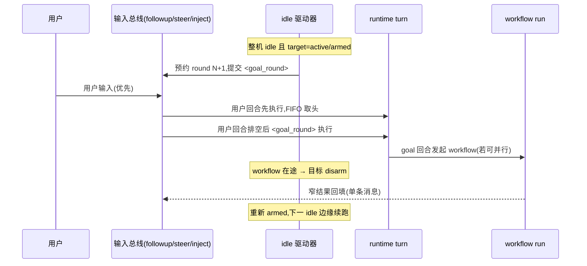

# 长程任务目标层重设计:goal × dynamic-workflow 三层组合方案

状态:提案(spec-first,未实现)。调研结论均标注来源与核实状态:标注 `已核实` 的条目带 file:line;标注 `待核实` 的条目在本仓尚未验证。

## 1. 问题与结论

产品判断(用户,2026-10):现有 goal(`/goal` target)不好用、不起作用。代码层面的机械差距见 §2.4。

结论:**goal 层按「dsh-goal 状态机骨架 + kimi-code 预算护栏」重建,dynamic-workflow 作为扇出编排层直接复用,底座复用现有 session 持久化 / compact / queue-steer,并按 dsh inbox/send 契约把输入提交三目标化(followup/steer/inject)。** 三层各自回答一个问题:

| 层               | 回答的问题                                         | 来源设计                                       |
| ---------------- | -------------------------------------------------- | ---------------------------------------------- |
| 底座(会话长跑)   | 一个会话怎么跑几十万 token、跨重启、断得起、记得住 | kimi-code 事件溯源 + 上下文即缓存;dsh 输入契约 |
| 目标层(目标持久) | 一个目标怎么跨回合活着,谁到点补下一发,预算怎么强制 | dsh-goal 状态机 + kimi-code 三维预算           |
| 编排层(并行扇出) | 一批子任务怎么确定性、可复现、可廉价重跑           | 本仓 dynamic-workflow(已有)                    |

## 2. 调研基础

### 2.1 kimi-code(全部经独立复核,file:line 相对 kimi-code 仓库根)

- 事件溯源:`wire.jsonl` append-only + fsync + 尾部自修复,**LLM 上下文本身是 replayable 状态**,恢复 = 作用域重建 + 事件重放(`src/state/eventDispatcherService.ts:762`)。压缩是 durable 事件,fold 时重跑同一个纯函数,在线与重放结果一致(`src/agent/contextMemory/contextOps.ts:79`)。
- 上下文即缓存:85% 阈值步间触发压缩、阻塞式挂起(`src/agent/fullCompaction/fullCompactionService.ts:502`);交接形状 = head ≤2k + elision + tail ≤18k + 模型自写摘要 + 续接(`src/agent/contextMemory/compactionHandoff.ts:10`);摘要带恢复指针(journal 路径 + 行号窗口 + 取回配方),原始字节永远在磁盘(`fullCompactionService.ts:647`);工具结果三级上限,超 50k 溢写为指针(`src/tool/toolContract.ts:7`)。
- goal 续跑回路:回合结束钩子提交 continuation 提示,每回合"一个有界切片"(`src/features/goal/goalService.ts:131,612`);每回合首步重新注入目标锚点 + **token/回合/挂钟三维硬预算**,超预算后工具调用被 veto、逼模型写终局总结(`goalInjection.ts:17`、`goalService.ts:562`);重启后 active 强制转 paused 交还用户(`goalService.ts:790`);用户 steer 打进正在跑的回合,排队消息永远优先于自动续跑(`goalService.ts:750`)。
- Tower/swarm:worktree 隔离 + 纯函数合并闸门 `missionGate` + `.tower/` 文件协议跨重启(`src/features/tower/protocol/missionGate.ts:93`)。

### 2.2 deepseek-harness(goal 与输入契约;来源:仓库 README 与 docs/subsystems/core.md,静态阅读)

- 状态层极小:`dsh-goal` 只存状态——事件溯源(active/paused/blocked/complete + 进程内 armed/disarmed),每次变更追加 `goal/change` 事件携带全量快照,revisioned GoalRef 防写过期;**goal 变更零上下文注入、零 KV-cache 影响**。每会话单目标。
- 续跑驱动是独立包 `dsh-goal-round-driver`:只在**整机 idle** 触发;预约-准入计数(`roundsStarted + 1` 预约,goal-sourced user message 准入后才计费;人类消息不消耗回合预算);每回合注入一条 `<goal_round>` 提示(objective + round/maxGoalRounds);回合上限默认 256,耗尽记 `round-limit` blocker;**每个 session-start 边缘(重启/resume/fork)强制 disarm,需人显式 resume**;编辑目标用 revision fence 使在途回合失效。
- 明确的非目标:不做 token/时间预算、不做独立评估器、不做跨会话派生。
- 输入契约(dsh core,`Agent.send(message, target, wakeup)` 三个固定别名):
  - `followup()` → `next-turn` 收件箱,自成独立回合;`steer()` → `next-step` 收件箱,"running driver 在下一个 step 边界消费";`inject()` → 下一 pre-step 消费且**不唤醒**空闲驱动器;
  - 收件箱是持久化投影:`next-turn` / `next-step` 两条有序表,insert/claimed/discarded 事件;`send()` 同步返回,wake 同步翻转 running 状态;
  - `agent/turn-stopping` 串行钩子:监听者可反对回合收尾并 steer,loop 重读收件箱;
  - cancel 类型化(`user/parent/hook/disposed`,首因生效,`keepInbox` 保留积压)。
- **实时性对照(修正一个常见误判)**:dsh 与 kimi-code 的 steer 都在 step 边界注入、都不能抢占在途 LLM 流(两家都只能 cancel)。steer 延迟的主导项是当前在途请求/长工具的剩余时长,两家相同;dsh 的优势在契约干净度与 `inject()` 语义,不是"模型更早看到消息"。

### 2.3 ZCode 现状(已核实)

- goal 实现分散四处:
  - CLI:`apps/zcode-cli/packages/cli/src/command-center/handlers/goal.ts`(`/goal` set/pause/resume/clear/replace,set/resume 后调 `continueActiveTarget` 一次性续跑);
  - v4 命令组:`apps/zcode-cli/packages/bootstrap/src/zcode-protocol-v4/commands/handlers/goal-compact.ts`(compact/sendGoalCommand/pauseGoal/resumeGoal,含 plan-goal 互斥、active-turn barrier、compactOperationLock);
  - 续跑回路:`apps/zcode-cli/packages/core/src/runtime/methods/target-continuation-loop.ts`——runtime command queue 里的 while 循环,轮间让位 pending 命令(用户优先语义已存在),可选 `targetCompletionVerification`;
  - 状态变更提醒:`apps/zcode-cli/packages/core/src/runtime/methods/goal-state-reminder.ts`(带 deferral 防 provider grammar 违规)。
- dynamic-workflow 引擎已在:`apps/zcode-cli/packages/dynamic-workflow`(纯包:facade/编译/静态分析/降级)+ `dynamic-workflow-runtime`(子进程 vm 沙箱 + NDJSON host 桥)+ bootstrap 侧生产驱动(actor sessions、SQLite journal)。`Date.now`/`fs` 运行期禁令保证可重放;amend 按子代理名 + 逐字 ask 匹配导入缓存。
- 底座已有:compact turn(goal-compact.ts 手动 compact 路径)、queue/steer(`input-admission.ts`)、restoreWarning 闸门。compact 的内部策略(触发阈值、溢写、恢复指针)待核实。

### 2.4 现有 goal 的差距清单(逐条对应 §3 的设计决策)

| #   | 现状(已核实)                                                                          | 差距                                                                               | 对应设计                                         |
| --- | ------------------------------------------------------------------------------------- | ---------------------------------------------------------------------------------- | ------------------------------------------------ |
| 1   | target 状态经 `setTarget/updateTargetStatus` 写入(持久化位置待核实),不是事件流        | 无 revision、无快照事件、重放语义不明                                              | §3.2 事件溯源状态机                              |
| 2   | 续跑 = 进程内 while 循环占用 runtime command queue(`target-continuation-loop.ts`)     | 回合计数是循环变量,不是持久状态;预算只有 CLI 展示的 tokenBudget/tokensUsed,无 veto | §3.2 预约-准入 + 三维预算                        |
| 3   | 触发点 = set/resume 命令 + `continueActiveTargetAfterTurn: true`(input-facade.ts:132) | 无 idle 边缘驱动;turn 结束即续,不区分用户是否排队                                  | §3.2 idle 驱动器(在 3 的基础上收敛,不新增触发源) |
| 4   | 无重启 disarm 语义(待核实:resume 后是否自动续)                                        | 重启/恢复后静默自跑风险                                                            | §3.2 disarm-at-restart                           |
| 5   | goal 状态变更注入 reminder(方向与 dsh 相反)                                           | mutation 注入会挤占上下文                                                          | §3.2 零注入原则(锚点注入归回合提示)              |
| 6   | goal 与 dynamic-workflow 零交互                                                       | 并行工作只能串行做,主会话上下文线性膨胀                                            | §3.3 workflow 桥                                 |
| 7   | 输入为 queue/steer 双目标,steer 靠 `origin.inTurn` 标志合并(input-admission.ts)       | 无"不唤醒"的 inject 语义;积压不是可重放投影;无回合收尾异议钩子                     | §3.5 输入契约                                    |

## 3. 方案

### 3.1 分层与状态所有者

```mermaid
flowchart TB
    subgraph L3["编排层 dynamic-workflow(已有)"]
        WF[workflow run: 类型化子代理扇出\nworld.run 确定性门 + journal/amend]
    end
    subgraph L2["目标层 target-state(重建)"]
        GS[target 事件流\nactive/paused/blocked/complete\narmed/disarmed(进程内)]
        GD[idle 驱动器\n预约-准入回合计数]
        GB[三维预算\ntoken/回合/挂钟 + veto]
    end
    subgraph L1["底座(已有)"]
        SE[session 事件持久化]
        CO[compact 上下文压缩]
        QS[输入总线\nfollowup / steer / inject]
    end
    GD -- "idle 边缘:提交 <goal_round>" --> QS
    QS -- "用户输入优先/steer" --> GS
    GS -- "goal 回合内发现可并行结构" --> WF
    WF -- "窄结果(单条消息回填)" --> QS
    GB -- "veto 工具调用" --> QS
    SE -- "事件重放" --> GS
```

状态唯一所有者:target 生命周期状态归事件流(§3.2);回合计数归驱动器(预约-准入);预算消耗归 runtime(usage 事件);armed/disarmed 是进程内标志,不持久——持久的是"重启边缘必须 disarm"这条规则本身。

### 3.2 目标层:事件溯源 target 状态机(dsh 骨架 + kimi-code 护栏)

**状态与事件。** 单 target/会话。durable 事件:`target/created`、`target/edited`(revision fence:编辑使在途回合失效)、`target/paused`、`target/resumed`、`target/blocked`(带稳定 blocker code)、`target/completed`、`target/cleared`(tombstone)。每事件携带全量后置快照。恢复 = 重放事件折叠;**任何 session-start 边缘(冷启动/resume/fork)后 target 强制 paused + disarmed,续跑需人显式 resume**。现有 `setTarget/updateTargetStatus/clearTarget` 保持签名,内部改为 dispatch 事件(调用方无感)。

**零注入原则。** target 变更本身不写任何上下文消息(现状的 `goal-state-reminder` 保留但只服务 UI/审计可见性,不再进模型上下文——待定,见开放问题 3)。模型可见的目标信息只有两个来源:每回合的 `<goal_round>` 提示和回合首步的目标锚点注入。

**idle 驱动器与预约-准入。** 替换 `target-continuation-loop.ts` 的忙碌循环:驱动器只在**整机 idle**(无 pending 命令、无在途 turn、无在途后台任务)时预约下一回合(`roundsStarted + 1`),以 goal-sourced user message 形式按 followup 目标提交 `<goal_round>`(objective + round/maxRounds,续跑提示要求"一个有界切片"),消息真正准入后才把预留转为已用;用户消息不消耗回合预算。用户排队的输入天然先于驱动器(它只在 idle 时预约),现状 `yieldToPendingCommands` 的让位语义因此自然成立,不再需要循环内检查。

**三维预算与终局。** 回合数预算(默认沿用 256)+ token 预算 + 挂钟预算。任一维度到达 75% 时,锚点注入切换为"收敛、勿开新工作"指引;到达 100% 时:target 置 blocked(稳定 code `budget-exhausted`),当前回合给一次宽限——宽限回合内工具调用被 veto,逼模型写面向用户的终局总结(终局 outcome prompt 随 `UpdateTarget{complete|blocked}` 的工具结果返回并终结回合)。预算强制点在 runtime(usage 事件后),不在提示词里恳求。

**与 plan-goal 互斥。** 沿用现状(goal-compact.ts 的 `guard.planGoalMutuallyExclusive`)。

### 3.3 编排层桥:goal 回合 → dynamic-workflow

- goal 回合内模型判断"这批工作可枚举、可并行、有机器判据"时,以一个工具(或既有 CreateWorkflow 面)发起 workflow run,然后**本回合结束、驱动器 disarm 该目标直至 workflow 回填**(workflow 在跑时目标不再空转续跑,消除双重驱动)。
- workflow 完成时向会话提交一条窄结果消息(结论 + 关键 findings + 产物引用),作为普通用户侧输入进入 queue——goal 回合拿到结果后继续裁决。主会话上下文按 KB 增长而非 MB。
- 判定权阶梯(写给续跑提示):确定性命令退出码 > workflow 内静态检查 > 主模型自由判断。可枚举验证工作一律进 workflow,goal 回合只做规划与裁决。

### 3.4 事件顺序(idle 续跑 vs 用户插队 vs workflow 回填)



### 3.5 底座:输入契约移植、复用与待补

**输入契约(移植 dsh inbox/send 模型,不是外挂组件)。** steer 不是独立模块,它就是 loop 的输入语义本身;所谓"用 dsh 的 steer",实际是把它的契约移植进本仓 loop——loop 单总线性质不变,goal 续跑、cron、workflow 回填仍全部收敛为同一套提交语义,只是提交目标从两个(queue/steer)变成三个:

- 提交三目标化:`followup`(下个回合,自成回合)/ `steer`(本回合下一 step 边界注入)/ `inject`(下一 step 消费、**不唤醒**空闲驱动器)。目标锚点注入、cron 心跳这类"不想抢跑道"的输入用 `inject`,现状 `reconcileWhenIdle` 式的局部特例收敛为通用语义;
- 持久化双列表投影:`next-turn` / `next-step` 两条有序表,替代现有 queue + notifications 的 `origin.inTurn` 合并路径;insert/claimed/discarded 事件入会话日志,重放可重建积压;
- `turn-stopping` 异议钩子:回合收尾前监听者可反对并 steer,loop 重读收件箱——给"等等还有话要说"留正式入口;
- cancel 类型化(`user/parent/hook/disposed`,首因生效)+ `keepInbox`:取消后积压去向显式化。

实时性预期要设对(依据 §2.2 的对照修正):移植后用户消息仍要等当前在途请求/工具结束才到达模型,不会更快;收益是契约清晰、`inject()` 一等化、积压可重放、取消语义显式。

**复用。** queue/steer 优先级语义(映射到三目标)、compact turn、restoreWarning 闸门、session 持久化。

**待补(按 kimi-code 经验优先级排序)。** compact 后的目标锚点重挂(压缩吞掉锚点后下一回合重新注入);compact 摘要的恢复指针(被丢原始字节的取回配方)——两项依赖 compact 内部策略,先核实再定。

### 3.6 迁移映射

| 现有                                                 | 去向                                                           |
| ---------------------------------------------------- | -------------------------------------------------------------- |
| `/goal` 命令(handler goal.ts)                        | 保留,set/pause/resume/clear 映射为 dispatch 事件;resume 即 arm |
| `continueGoalAfterChange`(goal-compact.ts:434)       | 保留入口,内部改为驱动器 arm + 立即预约(idle 时)                |
| `target-continuation-loop.ts`                        | 删除,被 idle 驱动器取代                                        |
| `goal-state-reminder.ts` 的 deferral 机制            | 保留(防 grammar 违规的通用解法)                                |
| tokenBudget 展示                                     | 升级为三维预算的强制执行,CLI 展示补回合/挂钟                   |
| `continueActiveTargetAfterTurn`(input-facade.ts:132) | 移除,由 idle 驱动器统一触发(避免双触发源)                      |

### 3.7 需求拆解:三档触发

「提示词→目标拆解」是模型在第一回合的工作,不是任何一层的功能;且三家 harness(kimi-code / dsh / 本仓)都没有对拆解本身的质量闸门——todo 契约校验清单状态、schema 校验格式、missionGate 类闸门校验合并条件,没有机制检查"拆解漏了什么、验收标准能不能验"。本节规定何时值得为拆解加编排,判断标准一条:**错误的拆解会不会牵引随后数小时的执行**。

| 档  | 触发                                                     | 形态                                                                                                                                                       |
| --- | -------------------------------------------------------- | ---------------------------------------------------------------------------------------------------------------------------------------------------------- |
| 小  | 一句话/需求清晰                                          | 不加编排:首回合模型直接建 target + todo,靠 §3.2 锚点注入与既有契约兜底                                                                                     |
| 中  | 大任务/需求复杂,但需求对象不被下游结构化消费             | 建 target 前加一个独立复核 subagent(fresh-eyes):挑漏项、歧义、不可验收的验收标准;意见经窄结果回填(§4.3 裁定 3 管道)进会话                                  |
| 大  | Requirement[] 将被下游消费(按执行形态分流、逐条对账验收) | 两阶段 workflow(Round 0):阶段一需求分析师产出类型化 Requirement[](id/内容/验收标准/依赖/执行形态 serial\|parallel\|verify);阶段二独立复核员;单条窄消息回填 |

- 无论哪档,target 只存锚(objective + 3-5 条验收线);Requirement[] 全文活在 workflow 产物(artifacts)里按需取回——锚点注入(§4.1 裁定 5)不随需求膨胀。
- 执行分流:serial 留 goal 回合;parallel 以 Requirement[] 为 workflow args 扇出;verify 配命令门。验收拿命令退出码对 completion criterion,不用模型自评(判定权阶梯,§4.3 裁定 5)。
- 防漂移:长跑中允许一次增量重拆;completion criterion 修改走 revision 语义(§3.2 edited 事件)。
- Round 0 与执行回合的关系:Round 0 = 拆解,Round 1..N = 执行(「持久回合」的完整工作原理)。

## 4. 阶段拆分

- **Phase 1(状态机与预算)**:target 事件化 + 三维预算 veto + 锚点注入 + 重启 disarm。不改触发模型,`/goal` 行为可回归验证。
- **Phase 2(idle 驱动器 + 输入契约)**:替换续跑循环为预约-准入;`<goal_round>` 提示;回合终局 outcome prompts;输入提交三目标化(followup/steer/inject)+ 持久化收件箱投影 + turn-stopping 钩子(驱动器的 idle 判定与锚点注入都建立在这套契约上)。
- **Phase 3(workflow 桥)**:goal↔workflow 互锁(disarm/回填)、判定权阶梯写进续跑提示、窄结果回填格式。

### 4.1 Phase 1 实施裁定(spec 增补,2026-10-25)

Phase 1 落地时对开放问题的裁定与所有权声明:

1. **事件落点(开放问题 1 的 Phase 1 裁定)**:`session_target` 行仍是折叠后的持久权威(冷恢复权威方向不变,`cold-event-merge` 不动);新增 SQLite 表 `session_target_event`(append-only,每行一个状态机事件 + 全量后置快照 JSON),由 adapters 的 session-target SQL 助手在行变更后同连接顺序写入——`setTarget/updateTargetStatus/clearTarget` 签名不变,调用方无感。live `TargetChanged` 事件继续作为 UI 投影。事件流成为权威的翻转留给 Phase 2+。
2. **状态机事件映射**:`created`(首建/fork 子行)/`edited`(replace,现状语义保留:新 targetID + 用量清零;在途回合失效由既有 targetID 不匹配闸门承担)/`paused`/`resumed`/`blocked`(持久状态仍写 `budget_limited`,事件携带稳定 blocker code `budget-exhausted`)/`completed`/`cleared`(tombstone,记被清 targetID)。run 计量(start/heartbeat/finish/account)不产状态事件,但两类例外必须落事件:①三维预算触发的 active→budget_limited 迁移产 `blocked`;②finish 携带显式 status 的状态迁移产对应事件——取消收口把 active 翻 `paused`(reason `turn-cancelled`;此时 `pauseActiveTargetForCancellation` 因 status 已非 active 早退,事件由 finish 路径落);崩溃恢复 active→paused 产 `paused` 事件(reason `interrupted-run-recovery`)。
3. **session-start 边缘 disarm**:挂点 `runtime.activatePausedTargetAfterResume`(bootstrap resume 链路必经,fork 子会话恢复同样经过)——active 一律强制 `paused`(事件 reason `session-start-disarm`),续跑需显式 `/goal resume`;armed/disarmed 本身为进程内事实,Phase 1 由 paused 状态本身承担(候选闸门只认 active)。
4. **三维预算**:新列 `turn_budget`(默认 256,显式 null 表示不限)/`turns_used`/`wall_clock_budget_seconds`(null 不限);token 维沿用既有列。回合计数只计 `inputSource='goal-continuation'` 的回合(用户消息不消耗)。强制点三层:①续跑命令启动前(executeTargetContinuationCommand)做回合边界检查,任一维 100% → 翻 `budget_limited` + 立即执行一次宽限终局回合(工具全 veto + 终局 outcome prompt);②回合中(runRegularTurnLoop 步边界)用 live 投影(tokenCount + 挂钟增量)评估,任一维 100% → 本回合剩余工具调用 veto(provider 请求不再暴露工具)并注入一次终局提示;③store 结算(finish/account)按三维翻 `budget_limited`。75% 收敛指引进入回合首步锚点与续跑提示。
5. **锚点注入**:新 per-request system-reminder source `target_anchor`,每回合首步注入(active target 时),内容 = objective(不可信包裹)+ 三维用量 + 75% 时收敛指引;turn 级释放,不进持久历史。终局提示用 source `target_budget_outcome`。
6. **CLI 展示**:`/goal` 摘要补回合与挂钟预算;旧协议 wire(zcodeSessionGoal/GoalStats)与 v4 GoalState 的预算字段投影不在 Phase 1(需 packages/shared schema 与桌面/web 同步,记入 Phase 2)。

### 4.2 Phase 2 实施裁定(spec 增补,2026-10-25)

Phase 2(idle 驱动器 + 输入契约)落地时的所有权与落点裁定:

1. **idle 驱动器落点**:空闲沿挂点是 `drainRuntimeCommandQueue` 的空闲沿(与 `workflowBlockedReminder.sessionIdle` 同点,`runtime-command-queue.ts`);驱动器主体在 `target.ts`(`scheduleIdleGoalRound`),复用单回合 `target-continuation` 命令做预约(`verifyBeforeContinue: true`)。旧三处触发源(手动忙碌循环、`continueActiveTargetAfterTurn`、task-notification 回填循环)全部删除,`continueActiveTargetLoop` 收敛为「arm + 立即预约一个回合」(§3.6 映射的落地形态)。
2. **armed / standing-down(进程内)**:armed 仅由手动续跑入口(/goal set/resume、v4 sendGoalCommand/resumeGoal 经 `continueActiveTargetLoop`)置位;候选闸门在预约时仍兜底校验 target=active。预约未兑现(命令返回 null:目标非 active/后台任务在跑/verifier 基建失败)时驱动器 standing-down,只消费下一个外部边缘,防止非终态 null 变成轮询循环;预约兑现(回合真实跑完)则继续在下一个空闲沿预约,goal 循环在边缘间展开。驱动器候选闸门额外排除:held 队列(`queueAutoDrain=false`)、外部提升窗口、pending 权限、在途后台任务(整机 idle 定义)。**增补(裁定 b,2026-10-25 常驻闭环验收发现)**:排队的用户输入必须先于驱动器的下一回合执行——验收复现(session_8f5b13fc):round 1 执行中以默认 sendText 排队的用户消息(ACK delivery=queue、session_input admitted)要等目标 complete 后才被 v4 auto-drain 提升,驱动器 round 2/3 先跑,用户排在了整个目标后面。queue 的『不打断当前回合』语义不变,只修正排空顺序:空闲沿若 next-turn 用户队列非空(事件投影 `nextTurnPendingInputs`,不含 guide/inject 车道),驱动器 quiet yield——不预约、不落 standing-down、armed 保持;既有提升路径(v4 auto-drain → sendQueuedNow,idle-only 租约)先跑用户回合,其闸门不再以 targetStatus 压队(active/paused/budget_limited 期间机器空闲即按 FIFO 提升,verifier 在途仍由前台执行挡住),回合终态统一补一次 auto-drain 重评(覆盖不经 v4 命令层的 core 发起回合);用户回合排空后的下一空闲沿驱动器照常预约。队列存储与提升机制本身不动,不新增车道。
3. **standing-down 必须同步落档**:drain 收口的空闲沿与回合命令的完成属同一微任务延续,驱动器侧 promise 反应(经 async 包装,≥2 跳)必然晚于空闲沿——预约标记(idleDriver)随命令传递,在 `runRuntimeCommand` 的完成/拒绝路径同步置位(实测复现:异步置位会让失败回合被空闲沿立即重约)。
4. **`<goal_round>` 轮次计算**:round = `turnsUsed + 1`(预约中的下一回合;用户消息不消耗回合预算,§3.2),maxRounds = `turnBudget`(null 不限,标签省略 max_rounds);有界切片要求("Work in one bounded slice this round…Do not try to complete the entire objective in a single round.")进入 `formatGoalContinuationPrompt`。
5. **预算终局补偿移入单回合命令**:旧循环在循环体内做的「回合翻 blocked 但回合内未交付终局 → 补发宽限终局回合」由 `executeTargetContinuationCommand` 在其回合返回后自带;非 goal 回合触发路径(旧 `continueActiveTargetAfterTurn` 的边界检查)本就不覆盖 blocked 状态(候选闸门只认 active),行为对齐。
6. **inject 车道落地形态**:`TurnSteerDeliveryMode` 增 `inject`(followup=queue / steer=guide / inject 三目标映射到同一 delivery 字段);admission 侧 inject 绝不 start turn(idle 时落 next-step 收件箱,busy 且可 steer 时并入当前回合 next-step 车道);消费侧 guide/inject 同为 next-step 车道(同一边界、同 FIFO);turn 收尾改投(fallback)只作用于 guide,inject 留在事件投影的 next-step 收件箱,由下一个起跑的回合经回合起点水化(`hydrateDeferredInjectInputsForTurnStart`,早于本轮自身输入,保持提交 FIFO)消费。账本(`session_input.delivery`,SQLite CHECK 约束 startNow/guide/queue)与 v4 wire 面(QueueItem delivery 仅 queue/guide)不扩枚举:inject 在两处均映射 guide(同为 next-step/内联语义),车道权威在事件日志与 `SessionProjection.pendingSteerInputs.delivery`。
7. **双列表投影**:`PendingSteerInputInfo` 增 `delivery`,TurnSteerQueued/DeliveryChanged 事件重放携带车道;`nextTurnPendingInputs` / `nextStepPendingInputs`(contracts)为两条有序表的派生选择器。insert/claimed/discarded 事件复用 TurnSteerQueued/TurnSteerDrained/TurnSteerDiscarded,重放可重建积压。task-notification 管道不改道(v4 有自己的合批/授权语义,Phase 3 评估)。
8. **turn-stopping 异议钩子**:进程内监听链(`registerTurnStoppingListener`,公开 API)在 text-only 收尾边界、Stop hook 之前串行运行;反对者自行经 steer/inject 补充输入,loop 重读收件箱(消费到内容才续跑,空异议无效),单独计数上限 3 次;监听者异常按同意收尾处理。与外部 Stop hook 的差异:无配置面、无 additionalContexts 门槛。
9. **cancel 类型化**:`TurnCancellationCause`(user/parent/hook/disposed)与 `keepInbox` 经 `stopActiveForegroundExecution` 随首因一次性落档(已 aborted 的执行不再改写);turn 取消收口读该记录:keepInbox=false 走 `discardPendingInput`(next-turn 与 next-step 一并清账,TurnSteerDiscarded reason turn-cancelled),缺省 true 保持现状(guide 改投 queue + held)。parent/hook/disposed 为契约预留,当前生产路径仅产生 user。
10. **锚点与 cron 心跳**:目标锚点维持 Phase 1 裁定 5 的形态(turn-local `target_anchor` reminder,回合首步注入、随回合释放)——它天然满足 inject 语义(不唤醒、不占跑道、step 边界消费),改走收件箱(持久 user 消息)反而违反该裁定。本仓不存在 cron 心跳输入 producer(cron 为 off-peak automation 自有回合);inject 通道为其预留。

### 4.3 Phase 3 实施裁定(spec 增补,2026-10-25)

Phase 3(workflow 桥)落地时的所有权与落点裁定:

1. **发起桥(最小桥接 API)**:goal 回合发起 workflow run 的面就是模型内 `CreateWorkflow` 工具(经 tool executor 的权限判定与后台追踪,goal-continuation 回合内天然可用),不新增工具;唯一缺口是 onDemand 灰度会话出生不注册工作流工具面。桥 = `continueActiveTargetLoop`(全部手动 arm 入口:`/goal` set/resume、v4 sendGoalCommand/resumeGoal 共用)在 arm 时调 `activateDynamicWorkflowTools`(新 source `goal_arm`),与 `/workflow`、run_control 同族的「本会话第一次真的要用到它们」信号。`dynamicWorkflowEnabled=false` 时注册门(`resolveRuntimeDynamicWorkflowToolsIncluded`)挡住工具,激活状态无害;非 onDemand 会话已激活,桥为 no-op;桥失败只记日志,不阻断续跑。armed 为进程内标志,重启 disarm 后 resume 需再过本入口,激活语义自洽(entry 补写与冷恢复按既有规则)。
2. **在途互锁(disarm)落地为闸门而非新增状态**:`executeTargetContinuationCommand` 的后台任务检查(`hasRunningBackgroundRuntimeTask`,registry 权威)从 `verifyBeforeContinue` 条件下移出为**无条件**——手动 resume 与 idle 驱动器(`scheduleIdleGoalRound` 的整机 idle 闸门,Phase 2 已有)同受约束,workflow run(及任何后台任务)在途时目标一律不续跑。不引入显式 disarm/re-arm 状态对:run 终态的回填通知轮本身就是「重新驱动」事件(通知轮排空产生新空闲沿,armed 从未翻转),显式状态对在多 run 并发、非 goal 会话误 re-arm、re-arm 时机上引入新状态机;§3.4 序列图的「重新 armed」由「armed 未变 + 回填制造的新空闲沿」实现。
3. **窄结果回填沿用 task-notification 管道,不改道普通 queue**(§4.2 裁定 7 的 Phase 3 评估结论):终态通知已是窄结果单条消息——summary(结论)+ result(顶层返回值,序列化截断 4k chars)+ reports(关键 findings)+ artifacts/scriptPath(产物引用),同批合并为一条 synthetic user message(`task_notification`,model-only)起一轮独立 model-only turn。§3.3「作为普通用户侧输入进入 queue」的语义由 priority `next` 与通知轮排空后的空闲沿驱动器续跑共同承担;用户排队输入仍先于驱动器回合(Phase 2 既有 FIFO 语义)。
4. **origin 标记与 provider grammar(开放问题 4 的裁定)**:workflow 回填有两条到达路径,均在合法边界——idle 会话走独立 model-only 通知轮(不落进在途 turn 的 tool_use/tool_result 之间);忙碌会话经 `drainPendingRuntimeCommandsForActiveLoop` 在 **model-step 边界**以 `task_notification_steer` 吸收进当前回合(与 guide/inject 的 next-step 车道同边界)。**无需复用 goal-state-reminder 的 deferral 机制**:deferral 防「回合进行中、非 step 边界」的注入(Stop 钩子暂停 goal 时 reminder 落在 tool_use 与 cancelled tool_result 之间),回填的两条路径天然不在该位置,deferral 继续服务 goal 状态变更 reminder。origin 标记沿用 `originMeta.backgroundSource="workflow"` + `workflowNotification` manifest(发射侧铸造,随 turnHeader 走协议),与 provider grammar 无冲突。
5. **判定权阶梯进续跑提示**:`formatGoalContinuationPrompt` 增可选 `options.workflowDelegation`——阶梯(确定性命令退出码 > workflow 内机器检查 > 主模型自由判断)与委派指引(可枚举、可并行、有机器判据的工作用 CreateWorkflow 扇出;发起后本回合收尾,run 在途目标停摆、窄结果回填后自动续跑)只在工具面在场时注入(`dynamicWorkflowEnabled !== false && dynamicWorkflowToolsActivated`),CreateWorkflow 缺席的会话不误导;`<goal_round>` 标签本身仍只承载轮次元数据(round/maxRounds/有界切片)。

## 5. 开放问题

1. target 事件流的落点:并入现有 session 持久化,还是独立 journal?(Phase 1 前需核实 `setTarget` 当前持久化位置)
2. `targetCompletionVerification`(每回合验证是否继续)与三维预算的 75% 收敛指引是否合并为一个闸门。
3. `goal-state-reminder` 是否保留模型可见性:状态变更零注入是 dsh 的干净解,但 UI 侧审计提醒仍有价值——归 UI 通知而非模型上下文,待定。
4. workflow 回填消息的 origin 标记:需要与 steer/injection 的 provider grammar 约束对齐(复用 deferral 机制是否足够)。
5. mid-stream steering(可选增强,dsh 与 kimi-code 都没有):用户显式插话时 abort 在途请求、携带追加消息立刻重发。代价是丢弃在途已生成 token + KV-cache 失效,因此只对用户显式插话开;kimi-code 的 resetHistory + retry 机器(溢出恢复路径)证明"中断→重建→重发"在该引擎可行,本仓需先核实 compact/重试路径是否可复用。这是唯一能实质缩短"模型看到用户消息"延迟的手段,优先级低于契约移植。
6. §3.7 三档的归档判定由模型首回合自判("大/复杂/需要结构化"),可靠性待观察;是否补一个显式用户确认档位(如 `/goal plan`)待定。
