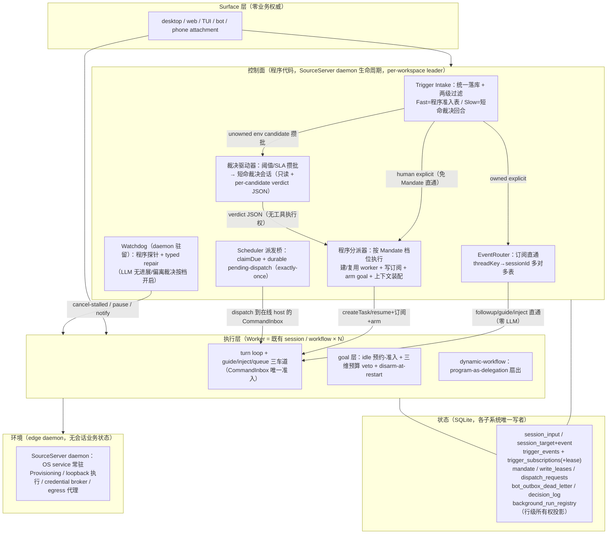

# 编程 Harness 最佳方案：Super-agent 设计定稿（确定性路由 + Mandate 授权自治 + 进程外看门狗）

状态：设计提案（spec-first，未实现）。本文是「编程 harness 最佳方案」的定稿，融合两条来源：
DeepSeek Harness 团队《Super-agent 设计探索：迈向更自主的 Agent 系统》（https://mp.weixin.qq.com/s/zoS7GlReWPhfCjENGxXCdg ，下称「文章」）的五模块架构，与本仓已实现的 dsh / kimi-code / zcode 三家融合底座（goal 层三方融合、输入三车道契约、dynamic-workflow、单一 CommandInbox、边缘 daemon 等，见 `docs/architecture/long-horizon-goal-redesign-plan.md`）。设计过程：10 个子系统现状图 → 4 视角独立方案评审团 → 综合 → 4 视角对抗性审校（6 致命 / 28 重大问题已全部修复合入，见 §7 审校修复记录）。

## 0. 摘要

四特征（连续/高效/主动/持久）的最优解不是再造常驻 LLM Router，也不是翻转持久化权威或拆进程，而是：**确定性路由主干 + 短命批量裁决回合 + Mandate 三档授权 + 物理静默投机 + 进程外看门狗**。编程工作台的事件归属几乎总是确定的（workspaceIdentity × 会话绑定已是协议事实），因此热路径零 LLM：已订阅 thread 的事件由 EventRouter 程序直通 CommandInbox 三车道，人类显式消息直通分派器免攒批免 Mandate；语义判断只发生在短命批量裁决回合（只读工具面 + per-candidate verdict JSON，程序解释执行，LLM 永不持有 dispatch 工具）；持久性补三个真缺口（终态唤醒再投喂、scheduler claim 下沉 daemon 配 exactly-once 派发桥、bot 出站死信）；安全先于扩张（webhook fail-closed、taint 信封、spec lane 出站强制、设备爆炸半径收口）。控制面全部是程序代码，从第一天起随 SourceServer daemon 生命周期存活——不存在「常驻实体排期到后期、前几期宿主悬空」的自相矛盾。

---

## 1. 设计目标与评价函数

**目标函数：单位人类注意力下的已验证编程产出最大化，正确性与安全为硬约束。** 人只应出现在两个点——授权与验收。上下文窗口是缓存：只有「下一步预期会被消费」的信息才配进模型；并发靠上下文隔离（worker session / dynamic-workflow），共享的只有准入顺序与窄结果；主动性必须先过噪音过滤与授权档位，否则主动性本身就在消耗人的注意力并扩大注入面。

四特征的可验收定义（含诚实边界）：

- **连续**：跨信道同一个 Agent 的体感 = 单一 CommandInbox 准入身份 + **跨信道 thread 归一**（同一 PR 的 IM 讨论与 GitHub 评论归同一 thread）+ 已订阅直通 + 派发时上下文装配 + 统一信道口径，不因窗口关闭或进程重启而断（disarm-at-restart 是显式暂停而非丢失）。文章旗舰用例（「IM 说方案 A、GitHub 评论改方案 B，同一个 Agent 理解并调整」）是 Phase 2/5 的黄金验收，不是开放问题。
- **高效**：owned 事件零 LLM 直达；unowned 环境候选攒批一次裁决；人类显式消息走低延迟直路（P95：resume <5s / 新建与现状持平）；worker 之间上下文隔离、靠窄结果回填。文章 §3.2 实测（-30% Router 决策、-27% 缓存读）是 dsh 常驻 Router 基线下的量级参照；zcode 侧可测基线是「新增触发面下攒批 vs 逐条裁决」的 token/延迟差。
- **主动**：触发面扩到 webhook / IM / 定时（git、file-pattern 为枚举预留、实现另期，见 §7），缺省 record-only（只记 would-accept 卡片），auto 档必须持不可变 Mandate；投机交付必须过判定权阶梯。
- **持久**：唤醒事实 durable 且**终态可再投喂**（不是只有审计痕迹）；scheduler claim 在 daemon 可达平台于 Desktop 关闭后存活（缺省 in-window 丢弃语义与现状对齐，durable-wait 需 opt-in）；kill -9 后通知可结算、goal 转 paused、订阅与积压可恢复。**诚实边界**：「持久」= 进程级可恢复 + daemon 可达平台的调度存活，不承诺设备在线——与文章云端常驻的差距显式声明，不做云端拓扑（§8 非目标③）。

**操作化度量集**（写进 Phase 2/3/5 验收；数值允许标定，定义不允许缺席）：
(a) 人类注意力事件数/周（打扰次数 + would-accept 处置数）；(b) 已验证产出（过交付闸且被用户采纳的 spec 草稿 / auto 任务数/周）；(c) 质量护栏（裁决误 accept 率、auto 任务相对手动基线的返工率、spec 草稿采纳率）；(d) 延迟与成本（人类 explicit 消息 P95、裁决 P50/P95、裁决单批冷启动 token）。

**裁决规则**：目标函数未要求的性质（逐字节 bit-exact 重放、Router 水平切分、云脑拓扑、A2A）一律不付工程费；把 LLM 放在高频确定性路径上、用提示词恳求代替 runtime 强制、或引入第二 accepted queue 的方案一律否决。四视角评审团以设计 B（演进式确定性路由）三胜为骨架，A/C/D 的最佳想法按「修复其致命伤后可增量落地」标准嫁接；对抗审校再推翻并修正 6 处致命问题（§7）。

---

## 2. 总体架构

### 2.1 分层与状态所有者

五层。状态唯一权威在 SQLite（物理落库见 §2.3），窗口只是 attachment；**控制面全是程序代码**，不养常驻 LLM 实体——这是与「常驻 Router 方案」的根本分叉点。



状态所有权（唯一写者）：`trigger_events` / `trigger_subscriptions` 归 Intake+EventRouter；`mandate` 归 Mandate 子系统；`write_leases` 归写工具 admission 检查点；`dispatch_requests` 归 scheduler 派发桥；`decision_log`（统一命名，勿再生别名）归独立 decision-log 子系统（唯一写者；裁决驱动器与 Intake fast-path 均经其仓储 API 写入——2026-11-02 裁决 8）；`session_input`/消息账本归 CLI persistence 适配层（既有）；`session_target(+event)` 归 goal 层（既有，行权威不翻转）；workflow journal 归 dynamic-workflow 引擎（既有）；bot 出站与死信归 botsService；`background_run_registry` 是**行级所有权投影**——每行 owner=注册它的子系统，仅 owner 写本行，终态由 owner 原子回写（对账轮兜底，看门狗探针按 staleness 上限读）。裁决会话/看门狗 LLM 裁决各自短命、互不共享 KV——记忆在 SQLite 与 worker 会话里，不在任何常驻 LLM 上下文里。裁决批粒度 = 每 workspaceIdentity 一批（权限、凭据、thread key 都是 workspace 域的；全局唯一裁决实体是 confused deputy）。

### 2.2 控制面组件 × 进程 × 阶段矩阵（修复审校致命伤 1）

| 组件 | 宿主进程 | 落地阶段 | 关窗 | 关 Desktop | kill -9 |
| --- | --- | --- | --- | --- | --- |
| Trigger Intake / EventRouter / 程序分派器 | SourceServer daemon（per-workspace leader 租约） | Phase 2 随派发桥同批 | 继续 | 继续（daemon 可达平台） | 重启后按 §4 流五重放 |
| Scheduler claim | SourceServer daemon（从 Main electronUtilityProcess 迁入） | Phase 2 | 继续 | 继续（同上；win32/WSL/Docker 矩阵为前置门禁） | claim 单飞 + pending-dispatch 幂等 |
| 裁决驱动器 + 短命裁决会话 | SourceServer daemon（与 scheduler 同生命周期） | Phase 2（修正原「Phase 4」错误） | 继续 | 继续 | 在途批作废重攒（未决行按幂等键重放） |
| Watchdog | SourceServer daemon 内（线程/子进程，**不**用 Main utilityProcess 形态——那随 Desktop 死） | Phase 4 | 继续 | 继续 | 连续重启计数升级告警 |
| Desktop-forked utilityProcess（现 desktopCronScheduler） | Main fork | Phase 2 后保留为平台回退 + UI 联动告警 | 继续 | 死（回退语义=现状） | 现状 |

单实例仲裁：控制面组件只在 per-workspace leader 租约持有者上运行（SQLite BEGIN IMMEDIATE + 心跳续期）；同 workspace 被多窗口/多 attachment 打开时，非 leader attachment 降级为纯转发——「多窗口同 workspace 只有一个裁决实例」是 Phase 2 验收项。Phase 2-3 的「主动」覆盖面验收写明：daemon 可达平台上关窗/关 Desktop 时 webhook/IM/定时事件仍被收、仍被裁决/直通；入站接收（bots WebSocket/长轮询）随 Phase 2 一并下沉 daemon——两把锁分清（2026-11-02 裁决 3）：provider **连接消费锁**（目录锁 + owner.json + nonce 心跳）已跨进程、承接宿主下沉；**消息级去重**以 trigger_events `UNIQUE(provider, provider_message_id)` 为权威（进程内 Map 只是快速守卫），否则「主动」在关机态不成立。控制面宿主按裁决 7（trigger-subsystem-spec §7-7）= daemon 受管子进程承载 bootstrap 组合根，里程碑 A 先落 Desktop 进程内全链、里程碑 B 迁 daemon。

### 2.3 物理部署（库与写者进程）

| 表 | 库 | 写者进程 | 跨进程协议 |
| --- | --- | --- | --- |
| session_input / session_target(+event) / 消息账本 | `~/.zcode/cli/db/db.sqlite`（既有会话库） | CLI runtime（host 内） | 既有 |
| automation / off-peak 现有表 | `tasks-index.sqlite`（WAL，既有） | scheduler（迁 daemon 后=daemon） | WAL 直写，BEGIN IMMEDIATE 单飞认领 |
| trigger_events / trigger_subscriptions / mandate / write_leases / decision_log | 新 daemon 域库（随 daemon） | 控制面（leader） | 会话侧只读经 RPC；写唯一 |
| dispatch_requests | 与 scheduler 同库 | 派发桥（daemon） | push/ACK 经 host RPC |
| background_run_registry | 投影，随各 owner 库 + 聚合视图 | 各子系统（行级 owner） | 只读聚合 |
| bot_outbox_dead_letter | 与 bots 既有存储同域 | botsService | 既有 |

schema 版本化走既有迁移机制；存量安装的表创建是纯增量（新表不影响旧路径），订阅回填见 M2。

---

## 3. 核心机制设计

### M1 单一 CommandInbox 准入 + 确定性 EventRouter（订阅直通）

**裁定**：CommandInbox 保持全渠道唯一 admission（key gate、per-session FIFO、幂等 commandId、admission 同步建 reservation），任何新事件源禁止旁路。新增 `trigger_subscriptions` 表（workspaceIdentity, threadKey, sessionId, lane, filters, lease）：owned（命中活跃订阅）事件由代码直通对应会话车道，不经任何 LLM。**车道语义按既有三车道拆清**（修复审校 major：inject 与 followup 不可并列写「不唤醒」）：busy → guide/inject 行内投递（inject 不唤醒、guide 步边界消费）；idle → followup 走 queue 并**明说经 autoDrain 唤醒起回合**（watch 事件用 inject：落 next-step 收件箱，由下一个真实回合起点水化）。订阅随 goal/workflow/会话终态注销，lease 续期（随 leader 心跳）与失效（启动时清过期 + owner 终态宽限回收）规则显式化。同 threadKey 多订阅者 = 多对多 fan-out：事件**单播进 CommandInbox 一次、由分派器复制为每订阅者一条带订阅者上下文的投递**（幂等键 = triggerId+subscriberSessionId），重复通知由 claim-once 吸收。

**理由**：文章 §3.2 实测直通省 30% Router 决策与 27% 缓存读（dsh 基线的量级参照）；本仓不变量「第二 accepted queue 是双写 bug 温床」。归属表是代码事实，比模型记忆可靠且天然跨重启。

**zcode 落点**：upgrade `apps/zcode-cli/packages/bootstrap/src/zcode-protocol-v4/command-inbox.ts`（准入序不动）+ `apps/zcode-cli/packages/core/src/runtime/methods/prompt-admission.ts`（delivery/触发来源枚举）+ `packages/shared/src/zcode-protocol-v4` envelope 字段——三处合同同步；build-new `trigger_subscriptions` 表与 EventRouter 模块（`apps/zcode-cli/packages/bootstrap/src/super-agent/trigger/`，复用 botsService 的 withAuthorizedContext/markInboundDelivery 语义）；keep steering.ts 三车道、command-queue.ts 合批。

### M2 Trigger 统一 intake + 两级过滤（含人类 explicit 直路）

**裁定**：所有**环境**事件（IM bot 消息、cron、off-peak、webhook、CI；git/file-pattern 仅枚举预留）先落 `trigger_events` 行（source/threadKey/actor/payload 摘要/disposition/taint）。Fast Path = 确定性准入表（来源白名单、群范围、addressed-vs-observed、bot 互答守卫 admitAutoReplyTurn、providerMessageId 三层幂等）输出三态。**路由三条边**（修复审校致命伤 2/3）：
1. `owned`（命中活跃订阅）→ EventRouter 直通（M1 车道语义）；
2. **`human-explicit`（addressed 且 actor=人）→ 程序分派器直通，免 Mandate、免攒批**：按 threadKey 尝试 resume 已终态（非人为停止）的 worker/会话（dsh「人类消息即刻 resume ticket」语义），无 resume 对象则立即建 worker（现状 bots 私聊 createTask 主路径不回退，验收「新线程首条直接消息延迟与现状持平」）；
3. `unowned env candidate` → 攒批交裁决（M3）。environment-triggered explicit 也走 ER/裁决，不走人类直路。

**车道归属裁定**（修复审校 major：workflow 回填双轨）：`trigger_events` 只做环境事件的 intake/审计层；**task-notification 的运行时投递保留 runtime-command-queue**（合批 + 活动回合 model-step 边界吸收 + claim-once 不动），EventRouter 直通只覆盖 CommandEnvelope 类输入（IM/CI/git/webhook）。本 agent 自己的终态窄结果不回流 Intake（见 §4 流一）。

**threadKey 规范与跨信道归一**（修复审校致命伤 4）：threadKey = workspaceIdentity + 域键，**同一工作对象跨信道归一、域键优先于信道键**——同一 PR 的 GitHub 评论与 IM 讨论归同一 thread（PR 域键），信道只作为投递属性。派发时上下文装配契约：新 worker 创建时注入关联 thread 的目标摘要 + 最近窄结果 + 未决问题 + recall 种子 ID 列表（dsh 式 assignment 卡片，内容上限约束）——recall 按需拉取不能替代派发时装配。文章旗舰用例（IM 方案 A → GitHub 改方案 B）写进黄金验收。

**存量迁移**：存量 bot conversation 启动时按 botDeliveryTarget 回填 threadKey 订阅；botsService 出口规范化按 bot 维度 feature flag 灰度；EventRouter 全局 kill-switch 一键回 legacy bots 直路。

**zcode 落点**：upgrade `packages/services/src/bots/botsService.ts`（processProviderCallback 出口规范化为 trigger 事件，保留既有去重/授权）；upgrade `packages/desktop/src/main/desktopCronScheduler.ts` 与 `packages/desktop/src/scheduler/index.ts`（claimDue）出口同化并迁 daemon；trigger 枚举扩 webhook|im|schedule 落 `packages/shared/src/automation-types.ts` 与新 contracts 类型；build-new intake 模块（bootstrap super-agent/trigger/）。

### M3 短命批量裁决回合

**裁定**：裁决不挂任何 goal 会话、不养常驻实体。宿主 = 裁决驱动器（纯代码，SourceServer daemon 内，与 scheduler 同生命周期，**Phase 2 同批落地**）。唤醒条件三选一即攒批：backlog ≥ N（默认 8）/ 最老 env candidate 年龄 ≥ T（默认 60s）/ 定时评估点（默认 5min）——与 goal 存在性完全解耦，无 goal 的 workspace 照常评估。执行 = 短命 model-only 会话（轻量模型档），工具面只读（trigger/订阅/目标摘要/recall），输出 **per-candidate** verdict（修复审校 major：整批同命运问题）：

```json
{ "decisions": [ { "triggerId": "...", "disposition": "accept|reject|record-only", "reason": "...", "evidence": ["..."] } ] }
```

`triggerId` 外键回 trigger_events 行；decision_log 按 triggerId 落行。**verdict 解析失败/schema 不过的批整体降级 record-only**（fail-closed 到最安全档）并计数。会话销毁；**短窗 KV 复用**：同一 workspace 在连续评估窗（默认 5min）内复用同一短命会话共享 prefill，窗末销毁——修复「每批冷启动、批处理经济学名存实亡」（审校 major），并为 N/T 初值标定提供冷启动单批 token 实测口径。预算 = 独立微预算（per-workspace 每日裁决 token 帽），与 goal 三维预算分账。**与前台隔离**（修复审校 major）：裁决/看门狗 LLM 走独立低优先槽或错峰，前台回合永不排队；Phase 2 压测验收「裁决批处理期间前台首 token 延迟不劣化」。

**理由**：两级过滤的 Slow Path 必须便宜且批量（文章 §3.1）；只读工具面 + verdict 由程序解释执行，物理切断「注入→裁决会话→分派」执行路径。

**zcode 落点**：build-new `bootstrap/src/super-agent/adjudication/`（驱动器 + verdict schema + decision_log）；复用 **automation/off-peak 的 model-only 回合路径（sendPrompt + toolDisallowlist）+ create-app 短命会话**（注意：dynamic-workflow driver 是工作流协议专用，无可复用的通用 model-only 派发 API——修正原引用）；轻量档模型经 ListModels pin 既有机制。

### M4 Mandate 三档自治授权

**裁定**：不可变授权记录 (workspaceIdentity, triggerClass, 档位 record-only|speculative|auto, scope, policyVersion, expiry)。Mandate 管「这件事轮不轮到你主动做」，PermissionRuleset 管「工具能不能执行」——分表分离。缺省 record-only = **隐式行**（查询层 UNION 缺省；修复审校 major：fail-closed 不得把未配置 workspace 全灭）；fail-closed 只针对「有 mandateId 但失效/越权」。**解析契约**（修复审校 major：同步管线无法查库）：mandate 在 prompt admission（异步点）解析，typed 结论（mandateVerdict + mandateId + expiry）作为 PermissionContext 必填字段注入；`checkPermission` 最前端只做同步 fail-closed 判定（缺失/过期/record-only 撞写操作 ⇒ deny），插入点在 plan-transition 解析之前（`core/src/permission/service.ts` 管线最前端）。turn 内 expiry 不中断在途回合，下一 admission 边界 revalidate；hook 修改输入 recheck 复用同上下文结论。**三条例外**（修复审校 major：慢路径自锁）：① 控制面自会话（裁决、watchdog-llm）以基础设施身份豁免（携带专用 infrastructure mandateId）；② 检查仅对 origin=event 的工具调用生效，user-origin 回合短路；③ 投机/自动回合 originMeta 必带 mandateId。context 变化（新 workspace、新远端 peer、policyVersion 变更）触发 revalidate。**与 disarm 的交互**（修复审校 major：后门静默续跑）：session-start-disarm 后 **mandateArm 不得直接 re-arm goal**；auto 档事件在 disarm 态只落 would-accept/通知，除非 Mandate 显式携带 `resume-after-restart` 字段（缺省无）。

**理由**：主动 ≠ 任意主动；没有授权语义，事件驱动就是注入的自助餐（dsh Mandate vs Subscription 分离的教训）。

**zcode 落点**：build-new mandate 表与冷启动闸（bootstrap super-agent/）；upgrade `core/src/permission/service.ts` + `permission-flow.ts`（PermissionContext 契约扩展）；沿 botDeliveryTarget 可信元数据模式铸造 originMeta。

### M5 投机执行 spec lane（静默复现-修复 + 出站强制选型）

**裁定**：speculative 档 + verdict accept 后，由程序以受限 profile 建 spec run（**Phase 3 = subagent 路径唯一**；workflow 形态在 profile 接线前禁止启动 spec run——2026-11-02 裁定）：workspace-write-only、无凭据、verdict 前出站两层强制——①**结构隔离（硬）**：spec 工具面不持有任何出站工具/信道句柄（WebFetch/WebSearch/ReplyToChannel/SendMessage/Workflow 族等全部剔除，mcp__ 前缀动态名同剔）；②**egress 协作式代理（env 级）**：per-workspace 本地 egress 代理（白名单 host 直通、其余拒绝；子进程经 env 注入 proxy 变量，复用 `applyNetworkEgressEnv` 通道；检查点 = spec restricted profile 启动时强制注入，无代理则 run 拒绝启动）。**诚实边界（2026-11-02 裁定）**：env 级代理可被 `curl --noproxy` / 不读代理 env 的客户端绕过——「物理隔离」仅指①结构层；②层如实登记为协作式强制，绕过对抗测试钉住残留，OS 级围栏（网络命名空间/防火墙）列入 Phase 6 前置；对外文案禁用「物理隔绝出站」。默认零 egress + 允许 per-repo 显式配置依赖代理白名单（仅 HTTP 到用户配置的 host，如 npm/pip mirror）；无凭据不变。仅裁剪工具面的替代方案被否决（CI 复现必须 Bash + 装依赖）。verdict 阶梯 = 命令退出码 > workflow 机器检查（world.run 非零退出是 VALUE）> 模型判断（必须附证据引用）；过闸才生成窄结果卡（草稿 PR 描述 + diff 引用）经既有 outbox/结果卡交付，失败静默丢弃只落 decision_log 计数。绝不自动 push/发消息。

**理由**：文章 §3.4 的价值前提是「有机器判据才值得投机」；出站结构隔离使被注入的群消息最多让 agent 在沙箱里复现一个失败测试，对外副作用被工具面与 egress 层拦到只剩协作式残留面。

**zcode 落点**：build-new spec restricted profile + egress 代理（daemon）+ spec-trigger 注册；upgrade automation/bots 出站加 speculative 投递规则；keep CreateWorkflow、task_notification、goal↔workflow 互锁（`target.ts` 后台任务无条件 interlock）。

### M6 判定权阶梯交付闸（作用域收窄）+ 多信道回复策略

**裁定**（修复审校 major：段内自相矛盾）：判定权阶梯**只作用于代码/工件类交付**（PR、diff、CI 修复、spec 草稿）：交付前必须过阶梯（退出码 > 静态检查 > 模型判断附证据）；goal 的 completion 继续走 targetCompletionVerification。**对话式终态回复豁免阶梯**，只受 reply policy 约束：thread 内终态回复由既有 bot outbox 直发（watchCronRunBotDelivery 订阅先于副作用、summary_changes 防刷屏）；跨 thread 打扰/全局通知/would-accept 卡片走统一 reply policy（IM ≤100 词硬规则进配置，GitHub/PR 走结构化高密度）。**回答者口径连续性**：跨 worker 共享 reply policy 模板 + 系统提示共享面（称呼/结论风格），维持「同一个 Agent」的声音契约。**方案卡格式（2026-11-02 用户裁定：核心价值=实时发现问题并提出最佳方案）**：所有「问题→方案」类交付（spec 草稿卡、would-accept 卡、CI 修复卡）必须按结构化方案门禁格式承载——现状证据（根因+file:line/日志）/候选方案（≥2，各带代价）/最佳推荐（第一性原理理由）/影响面（文件、兼容、回滚）/验证方案（命令+判据）；一句话摘要不构成「最佳方案」。

**两类方案卡（2026-11-02 用户裁定：实时最佳方案 + 下一步最佳方案）**：同一流水线（证据→候选→论证→卡→人裁决）两个实例。(a) **问题卡**（实时环）：环境事件触发，走 intake/裁决/spec-lane 静默复现，低延迟直路，论证=判定权阶梯；(b) **路线卡**（前瞻环）：状态边缘触发（goal 回合边界/idle/里程碑/阻塞点），走 goal 层边界钩子，论证=第一性原理对齐目标函数 + 验收可测性（候选下一步 ≥2 各带代价、最佳推荐理由、验收判据），延迟档可攒批。Mandate 调节打扰度：record-only 两类卡全呈现；auto 档问题卡静默执行、路线卡静默选路但留审计；显式档只呈高价值卡。路线卡落点：goal 回合起点（有界切片选择）与阻塞/岔路边缘，经 would-accept 收件箱同面呈现，不新开信道。

**理由**：人只复核机器给的证据，不复核推理过程；thread 已隔离对话域，强制所有回复过审批层只增延迟。

**zcode 落点**：keep dynamic-workflow world-run 语义、target-completion-verification、botsService.sendOutbound / watchAutomationRun；upgrade formatGoalContinuationPrompt 的 workflowDelegation 提示扩展为交付前 checklist；build-new reply policy 配置（词限/模板/口径）。

### M7 持久底座：终态再投喂、exactly-once 派发桥、出站死信

**裁定分三刀**（① 为审校修正后的真实缺口——原「先落 durable 行」是空刀，账本自开源起就有）：
① **终态唤醒再投喂**：现有 wake 账本（session_input kind=backgroundNotification）+ resume 显式结算（discarded(session_resumed)）保留不动；补真缺口——**崩溃后主体仍存活的工作按类型判别重投**，实现收敛为**账本驱动 + journal 校验**（2026-11-02 确认，详见 super-agent-wake-refeed-spec.md §2）：候选集 = 账本中 discarded(session_resumed) 的 backgroundNotification 行（「曾被 wake 且未消费」的唯一事实来源；纯 journal 枚举分不清 policy 抑制 / TaskOutput 已消费 / 从未 wake，会误投），journal 只判主体可恢复性（workflow 终态且非 superseded）；按幂等键 `refeed_<taskId>` **claim-first** 落账后重新 enqueueBackgroundTaskNotification（claim-once 保证不双投）；死 Bash/死 subagent 的 wake 按现状丢弃、保留 ledger 审计。验收：「kill -9 时在途 workflow 已完成的，重启后 worker 能收到其 task-notification 且不重复；死任务 wake 丢弃且 ledger 可审计」。
② **scheduler claim 下沉 daemon + exactly-once 派发桥**（修复审校 major：交接协议）：claim 认领成功写 `dispatch_requests` pending-dispatch 行（含稳定 commandId = hash(runId)）→ push 到在线 host attachment 的 CommandInbox → **host ACK（CommandInbox admission 回执）后才 settle dispatched**；崩溃重投靠 commandId 幂等吸收（「push 后杀进程再重启不双跑」为 kill-point 测试）；skipped 结算仅由宽限定时器触发且与 push 状态 CAS 互斥。缺省 dispatchPolicy=in-window（宽限内无 dispatcher 则 settle skipped(no_dispatcher)，语义与现状 misfire 对齐、不比现状更糟），opt-in durable-wait（挂起至 host 回连，带最大陈旧期）——**§1 持久承诺带此限定**。win32/WSL/Docker 可达性矩阵是 Phase 2 前置门禁，不过的平台保留 electronUtilityProcess 回退路径。
③ **bot 出站死信与重试权威**：现状删除/禁用/发送失败仅节流 warn，补死信表 + 重试 + 死信可见性。

**理由**：持久的定义是「关窗口不死、崩溃可恢复」；claim 迁走而不解决派发宿主会制造半孤儿态——exactly-once 桥把「调度」与「执行宿主」显式分离，是控制面为程序代码的直接推论。

**zcode 落点**：upgrade `background-notifications.ts`（重投例外）+ `runtime-command-queue.ts`；upgrade `desktopCronScheduler.ts`/`scheduler/index.ts` → daemon 内 scheduler（带 automationRepo BEGIN IMMEDIATE 单飞认领）；build-new `dispatch_requests` 表 + ACK 协议；upgrade botsService 出站死信。

### M8 BackgroundRun registry（行级所有权投影）

**裁定**：不合并 automation（misfire-skip）/off-peak（ticket 顺延）/workflow/goal 四套写路径与状态机（异质语义强行归一回归面大于收益）。所有 run 在启动时注册进 `background_run_registry`（id、kind、ownerSession、终态、窄结果引用、stall 时钟指针）；**行级所有权**：每行仅 owner 子系统写本行终态（原子回写；对账轮兜底），registry 不是第二写者、不在准入路径上；task-notification 发射与健康探针只读 registry（staleness 上限 = 对账周期，写进 M10 探针规格）。跨系统 cancel 靠稳定 id。

**理由**：人类与看门狗只需一个「现在后台在跑什么」的观察面；观测统一、写路径不动。

**zcode 落点**：upgrade bootstrap background task registry + dynamic-workflow-run-track.ts、automationService、off-peak ticket 各自注册钩子；upgrade background-notifications.ts 发射点改读 registry。

### M9 引用图链式召回 + compact 结构化恢复指针 + 数据保留

**裁定**：不建向量库。给 trigger/subscription/target/workflow-run/artifact 统一稳定 ID；注入遵循「最少信息 = ID + 摘要 + 下一跳 ID」；完整内容留窗口外，经 recall 只读工具分页取回（每页自带下一跳引用，dsh orchestrator_read 形状；按 workspace/session scope 过滤）；长内容溢写沿用 ToolArtifactStore 三级（inline/truncate/artifact）。裁决回合与 worker 都可用 recall。**compact 结构化恢复指针**：compact 摘要强制输出结构化字段（objective / criterion / file-map / open-questions / recall 种子 ID），persistCompactSummary 的 CompactionPart metadata 增 `recoveryPointer`，续跑/hydrate 时重挂 anchor——锚点跨压缩存活从「押模型自由文本」变成机制。**数据保留**（修复审校 major：无界增长）：trigger_events 保留近 30 天 + 归档聚合；decision_log 滚动窗口 90 天；订阅/租约终态行随 owner 终态 + 宽限清理；dispatch_requests 终态行保留 30 天。**跨月记忆**：显式产品边界——当前设计服务月内任务连续性；跨月长程记忆是开放路线（per-workspace 分层摘要对象进引用图），不预支工程费。

**理由**：编程对象关系（PR↔commit↔workflow run↔target 事件）本就是显式引用图，比相似度检索确定可审计。

**zcode 落点**：build-new `core/src/tool/handlers/recall.ts` + contracts 资源 ID 类型；upgrade `result-serialization.ts` 溢写预算与 artifact URI；upgrade `compact/prompt.ts` 摘要 schema 与 `compact-persistence.ts` recoveryPointer（需 spike 验证与 preservedSegment/boundary 恢复路径协同）；keep compact-active.ts 原子摘要持久与 boundary 恢复指针。

### M10 进程外看门狗（daemon 驻留 + 偏离检测）

**裁定**（修复审校 major：进程形态自相矛盾 + 「90%」无据断言）：看门狗驻留 **SourceServer daemon**（与 M7 scheduler 同迁；不采用 Main utilityProcess 形态——那随 Desktop 死，保护不了 daemon 侧持久面）。Desktop-forked utilityProcess 只保留桌面存活期的 UI 联动告警。程序探针持续跑：registry stall、run-stalled（workflow 20min 时钟）、goal budget_limited 带未决问题、trigger 积压龄、dispatch pending 超龄、daemon 心跳、权限 pending 超时、连续重启计数。动作分级且 typed：cancel-stalled（仅允许 cancel 带 stall 时钟的 run）/ pause 问题 workspace 自动化 / notify 用户。**偏离检测最低配**（程序探针测不了「偏离目标」语义类，这是文章 §6 立论主类）：goal 在途时每个 idle 轮附带一次只读 progress-vs-objective 校验（goal 续跑提示 + registry 近况对比），连续 K 轮零进展/关键词零命中自动开启一次 LLM 无进展裁决（短命会话、只读 + 枚举动作）；LLM 裁决按 workspace 计费可见（UI 呈现位见 §6）。裁决产出 repair 提案，由程序校验枚举合法性后执行；连续 N 次 repair 失败强制 pause goal 并通知。看门狗无提示词/策略编辑权（否决文章 §6 的在线自编辑——混淆代理人后门）。「偏离类异常的检出延迟」纳入 Phase 4 验收。

**zcode 落点**：build-new watchdog 模块（daemon 内）+ 探针查询（registry/journal 只读）；upgrade host 崩溃路径对接重启；keep automation claim/settle、workflow stall clock、target 预算 veto 作为投影数据源。

### M11 输入三车道保持 + goal 层收尾 + 最小人工接管

**裁定**：guide/inject/queue 契约与 best-effort 语义原样保留（长工具批期间 guide 阻塞改投 queue 是契约事实；其结构解——streaming-tool-coordinator 步内边界——留开放问题）。不做 mid-stream 抢占默认化；仅保留 sendNow 单档 spike（在途请求未发首个 tool call 时 abort+追加重发），需先核实可复用 reactive-compact 重试机。goal 层：idle 预约-准入、quiet-yield、standing-down、三维预算 mid-turn veto、disarm-at-restart 全部 keep；goal-state-reminder 降为 UI/审计通知，删除写模型上下文路径（零注入原则落地）；goal-layer 灰度转正（`--goal-layer` 默认开，删旧忙碌循环 `target-continuation-loop.ts` 与 inject→queue 降级残留）；arm 入口增 mandateArm（携带 mandateId 的事件触发 resume，受 M4 的 disarm 交互约束）。**最小人工接管**（文章 §8.2，修复审校 major：悬空）：对 auto/投机 worker 提供 takeover = 撤订阅 + 停 goal（用户取消语义）+ 会话转用户直控，复用既有 pause/clear 工具链；不做实时并肩编辑（非目标）。

**zcode 落点**：keep steering.ts、turn-guide-drain.ts、hydrateDeferredInjectInputsForTurnStart、target.ts 驱动器；upgrade goal-state-reminder.ts 改 UI 通知源、prompt-admission.ts 增 sendNow-abroad（spike 后定）；remove target-continuation-loop.ts 旧路径。

### M12 规模化三件套

① **写互斥租约（收窄 + 检查点下移）**（融合审校两版修正）：租约只服务「spec-lane 静默 run vs 活 worker」这一真实并发写场景，scope = spec run 声明的文件集；其余场景靠订阅 fan-out 互见（文章的答案）不加第二套机制。检查点在 **workspace 写工具 admission 处查 lease 表**（与 permission path policy 同层），覆盖手动 session/subagent/workflow——不经分派器的写者也拦得住；第二写者直接响亮拒绝（不排队，避免载体崩溃丢）；租约随 worker 终态 + 宽限回收，启动时清过期（§4 流五）。
② **裁决日志 eval 闭环**：fast-path disposition、裁决 verdict、would-accept→auto 转化全落 decision_log，off-peak 定时导出回归数据集，标定准入表初值与轻量模型档位。核心指标 = would-accept→auto 转化率 + 裁决误 accept 率（联合标定打扰阈值）。
③ **模型分档与预算强制点**：枚举 adjudicator=轻量档 / watchdog-probe=纯程序 / watchdog-llm=轻量档按档开启 / worker=主档；经 provider registry + ListModels pin 强制。微预算在 runtime usage 事件统一点计量，goal 三维预算管用户目标，两者分账；控制面 LLM 与前台的槽位隔离见 M3。

**zcode 落点**：build-new write_leases 表（spec-lane 作用域）+ 写工具 admission 检查；build-new decision_log + off-peak 导出；upgrade contracts 模型档位类型。

---

## 4. 事件与状态设计

**关键流一：trigger→filter→route→worker（三条边）**

```mermaid
sequenceDiagram
  participant Src as 事件源(bots/cron/webhook/CI)
  participant Intake as Trigger Intake(控制面/daemon leader)
  participant ER as EventRouter
  participant Adj as 裁决驱动器→短命裁决会话
  participant Prog as 程序分派器
  participant Inbox as CommandInbox(唯一准入)
  participant W as Worker session/goal/workflow
  participant Ver as 交付闸(verdict 阶梯)
  participant Out as 信道 outbox
  Src->>Intake: envelope(taint 铸造,凭据零字节)→trigger 行
  Intake->>Intake: Fast Path: 白名单/幂等/互答守卫→三态
  alt owned(命中活跃订阅)
    ER->>Inbox: followup/guide/inject 直通(零 LLM,车道语义见 M1)
  else human-explicit(人显式/addressed)
    Prog->>Prog: resume 已终态 thread 或立即建 worker(免 Mandate/免攒批)
    Prog->>Inbox: createTask/resume+上下文装配+写订阅
  else unowned env candidate
    Intake->>Adj: 攒批(阈值/SLA/评估点)
    Adj->>Adj: 轻量档+只读→per-candidate verdict JSON→销毁(短窗 KV 复用)
    Adj-->>Prog: decisions[triggerId→disposition]
    Prog->>Prog: 查 Mandate 档位 + spec-lane 写租约
    alt auto 档 + accept
      Prog->>Inbox: createTask/resume + 写订阅 + mandateArm(受 disarm 约束)
    else speculative 档
      Prog->>W: 受限 profile 静默 run(egress 代理强制,无凭据)
    else record-only(缺省)
      Prog->>Prog: would-accept 卡片(UI,可批转 auto)
    end
  end
  W->>W: goal 互锁/三维预算/后台任务
  W->>Inbox: 终态窄结果(task-notification,唯一路径;先落 durable 行,可再投喂)
  Inbox->>Ver: 代码/工件类交付过阶梯(退出码>静态检查>模型证据)
  Ver-->>Out: 过闸→thread 内 outbox 直发(对话回复豁免阶梯,只受 reply policy)
  Ver-->>Prog: 不过闸→静默丢弃+decision_log 计数
```

所有权：trigger 行/订阅表=控制面 leader 唯一写者；verdict 由裁决会话产出但只有程序分派器能解释执行；worker 会话只经 CommandInbox 收输入；**终态窄结果唯一路径 = task-notification → CommandInbox，不回流 Intake**（防双入队）；outbox 元数据（botDeliveryTarget）由 host/服务端注入，模型不可伪造。

**关键流二：用户 mid-run steer**：composerSendNow → envelope requestedDelivery=guide → CommandInbox 幂等准入 → prompt-admission 判 steerable（无附件、activeTurn.steerable）→ steerTurn 推 guide 车道 → ACK turn_steer_queued → 合法步边界消费（每边界最多一条）；回合结束未消费 guide 回落 queue（guide.noToolBoundary/turnInterrupted）。降级如实呈现（不承诺 guidance）。不做在途 LLM 流 abort（sendNow-abroad 仅 spike）。所有权：guide/queue 事实归 runtime-command-queue，UI pending-guide 投影是拆分展示不是第二入队。

**关键流三：worker 完成→验收→用户**：workflow/子 agent 终态 → claim-once 结算 → registry 行终态（owner 回写）+ durable 通知行 → runTaskNotificationBatch 合批成单次模型轮（或活动回合步边界吸收）→ owner 会话窄结果消费 → 代码/工件类过交付闸 → thread 内 outbox 直发；跨 thread/全局走 reply policy。goal 在途时后台互锁，通知回合制造新 idle 边沿驱动续跑。

**关键流四：看门狗介入**：探针读 registry/stall/积压龄（staleness ≤ 对账周期）→ typed repair（cancel-stalled / pause / notify）；goal 在途 idle 轮 progress-vs-objective 校验零进展 K 轮 →（按档）LLM 无进展裁决 → repair 提案 → 程序校验枚举后执行 → decision_log + 可通知用户；连续 N 次失败 → pause goal + 升级告警。看门狗永不直写业务状态、永不编辑提示词。

**关键流五：崩溃恢复**（覆盖新增 durable 面，修复审校 major）：
1. accepted 未消费输入在 session_input（admitted）→ 沿既有 resume 显式结算 discarded(session_resumed) 带审计；
2. **终态再投喂**（M7①）：resume 链以账本 discarded(session_resumed) 行为候选集、journal 校验主体可恢复性，终态窄结果按 `refeed_<taskId>` claim-first 幂等重发；死任务不重投；
3. `trigger_events` 未决行启动扫描重放：explicit 重入分派、candidate 重入攒批（幂等键 providerMessageId/commandId，防双分派）；
4. 在途裁决批作废重攒；**decision_log→建 worker/写订阅同库原子**（跨库则 outbox），crash 不出「有判决无 worker / 有 worker 无判决」；
5. `dispatch_requests` 停在 pending 的按 ACK 状态续推或 skipped（CAS）；
6. write lease 与订阅 lease 启动清过期；leader 租约重新竞争；
7. armed 位 in-process（预期），goal 走 disarm-at-restart（mandateArm 不得后门 re-arm，M4）；
8. 看门狗读连续重启计数，N 次失败升级告警。

恢复承诺：进程活着即可恢复；设备关机不承诺（产品文案诚实）。

goal 生命周期状态图（keep）：active →（预算耗尽）budget_limited →（暂停）paused →（disarm）paused(session-start-disarm)；workflow 在途 = continuation 返回 null；终止经 verifier。

---

## 5. 安全与隐私

信任模型三层，任一层被攻破不级联全设备。
① **输入与指令权威边界**：机器信道输入为不可信数据，Intake 铸造 taint 元数据（沿 botDeliveryTarget 可信模式，supervisor 铸造、客户端不可伪造），taint 永不构成指令权威、只能作数据被引用；两级过滤只决定行动与否、不解除 taint；裁决会话只读工具面 + verdict 由程序解释执行——注入命中裁决会话也无法执行任何工具。
② **授权与执行边界**：Mandate 是主动性的唯一开关且缺省 record-only（M4 解析契约 + 三条例外）；spec lane 无凭据、出站结构隔离（工具面无出站）+ egress 协作式代理（env 级，绕过残留见 M5 诚实边界）、verdict 前零出站；PermissionService 管线最前端 mandate 同步 fail-closed 判定，alwaysAsk 不可被 hook 抹除、hook 修改输入后 recheck 机制保持；写操作仍过单一有序管线；spec-lane 写租约互斥（M12①）。
③ **凭据与设备边界**：凭据零上下文不变量（sanitizeZCodeRuntimeEnv / CUA broker 模式）；路线图推进短期可吊销能力票据（edge broker 换取注入、模型与协议帧只见票据 ID、随 attachment 失效）；PermissionRuleset 增 deviceScope/attachmentRole，手机/web attachment 默认 read-mostly（禁裸 Bash/凭据工具，写操作降确认），吊销即时杀票据与 attachment——关闭「被攻破手机继承桌面全量工具权」的爆炸半径。

触发扩容前置安全债 Phase 0 清偿：webhook secret 空值 fail-open（`botsService.ts:3838` `if (expectedSecret && expectedSecret !== inboundSecret)` 空值跳过）改为 fail-closed，与同文件 `:3714` Feishu 路径语义统一；trigger 原文与凭据不落日志（现有分级纪律）。已知残留并显式接受：plugin hooks 以 agent 进程继承 env、无 per-plugin 文件系统禁闭（本期不扩 plugin 权限面）；MCP OAuth 无 workspace 维度记为后续债务；同 UID 本机攻击面不承诺。交付前机器验证兼作注入缓解（错误指令难过退出码 + 测试双闸）。

---

## 6. 新增人机界面（修复审校 major：UI 缺失）

| 表面 | 内容 | 阶段 |
| --- | --- | --- |
| would-accept 收件箱 | record-only 卡片列表（来源/摘要/建议档位），一键批转 auto（= 写 Mandate）；desktop/web 渲染卡片，TUI 降级为列表命令 | **Phase 2 与裁决同批**（否则 record-only 无人可见） |
| mandate 管理 | 档位/过期/revalidate 视图与操作入口；计费可见位（裁决/看门狗 LLM 消耗按 workspace 展示） | Phase 3 |
| 统一后台观察面 | background_run_registry 投影 + 手动 cancel 入口 | Phase 4（探针同批） |
| repair 通知 | 看门狗 repair/升级告警走既有 notify 通道 | Phase 4 |

协议投影字段（v4 snapshot 扩展）：`pendingWouldAccept[]`、`mandateState`、`backgroundRuns[]`、`watchdogAlerts[]`——遵守 additive-optional skew 策略（unknown≠0）。手机/远程面同 protocol 投影，replayable 语义照旧。

---

## 7. 在 zcode 上的演化路线

**Keep（回归锚）**：CommandInbox 唯一准入（`bootstrap/src/zcode-protocol-v4/command-inbox.ts`、`core/src/runtime/methods/prompt-admission.ts`）；三车道 steering.ts + turn-guide-drain.ts；goal 驱动器/三维预算/disarm（target.ts）、session_target 行权威 + 事件侧车（session-target.ts）；dynamic-workflow 全套（journal、settle-order、amend-resume、stall clock、world-run VALUE 语义）；goal↔workflow 互锁；双 deliveryProfile 黄金测试（zcode-protocol-v4 profiles.ts）；cold resume 链；bots 三层幂等/互答守卫/outbox/订阅先于副作用；automation claim/settle（BEGIN IMMEDIATE、misfire 语义）；edge daemon 常驻与 attachment 模型；凭据加密存储与 env 净化；workflow-skill-gate 渐进能力激活；fault matrix 六不变量。

**Upgrade**：prompt-admission 触发来源枚举（与 wire schema 同步）；botsService/cron 出口规范化为 trigger 事件；background-notifications 终态再投喂例外；desktopCronScheduler → daemon 派发桥；PermissionService mandate 解析契约 + taint + deviceScope；goal-state-reminder 改 UI 通知；compact 摘要 recoveryPointer；result-serialization 溢写预算；BackgroundRun registry 注册钩子；TUI steer 反馈补齐。

**Add（build-new）**：`bootstrap/src/super-agent/{trigger,intake,adjudication,mandate,watchdog,write-leases,decision-log}/`；recall.ts 只读工具；spec restricted profile + egress 代理；dispatch_requests + ACK 协议；reply policy 配置；would-accept/mandate UI 投影；能力票据（Phase 6）。

**Remove**：target-continuation-loop 旧忙碌循环与 inject→queue 灰度降级残留；模型上下文内 goal-state-reminder 路径；（不做即移除清单）常驻 Router、journal 翻权威、Loop Worker 拆分、Task Ledger 合并、向量库。

**分阶段**（每期独立可回归；**四来源回归套件**=CLI/桌面/web-手机/IM bot 四入口的同一套 admission/车道语义回归，与 CommandInbox 不变量 + fault matrix + 双 delivery 黄金测试每期必跑）：

- **Phase 0 安全收口**：webhook fail-closed 统一（`botsService.ts:3838`）；taint 字段协议落地；trigger 原文不落日志。验收：伪造 secret 的 webhook 被拒；Feishu/webhook 两路径语义一致。
- **Phase 1 持久底座**：终态再投喂（按任务类型判别）；bot 出站死信；goal-layer 转正 + 零注入 + 删旧循环。验收：kill -9 时已完成 workflow 的通知重启后可达且不重复；死任务 wake 丢弃留审计；goal 全命令回归。feature flag：goal-layer 转正开关保留（默认 on，`--goal-layer off` / `features.goalLayer=false` 可关）；旧循环随 M11 Remove 清单删除，关闭后为削减语义（无 idle 驱动器、无三维预算的单回合手动续跑），**不再有回旧循环的 kill-switch**——回滚手段是 git revert 而非运行时开关。
- **Phase 2 EventRouter + 触发面 + 派发桥 + 裁决**（控制面整体落 daemon，含 leader 租约与 daemon 可达性门禁）：订阅表 + 准入表 + trigger 枚举（webhook/IM/schedule；git/file 预留）+ 短命裁决（全部 record-only）+ dispatch_requests exactly-once + 存量订阅回填 + would-accept 收件箱。验收：owned 事件零 LLM 直达；**人类 explicit 直通延迟与现状持平**；无 goal 的 workspace 也评估 unowned 候选；无 Mandate 只记 would-accept；「多窗口同 workspace 只有一个裁决实例」；「裁决批处理期间前台首 token 延迟不劣化」；「push 后杀进程再重启不双跑」；关窗/关 Desktop 下主动继续（daemon 可达平台）。feature flag：EventRouter 按 bot 维度灰度 + 全局 kill-switch 回 legacy 直路；裁决驱动器故障时 intake 降级 = 告警 + candidate 直落 record-only（不堵 intake）。
- **Phase 3 Mandate + 投机**：授权表、originMeta.mandateId、spec 静默 run（egress 代理强制）、verdict 出站门。验收：一次真实 CI 失败经 spec lane 产出草稿卡且 verdict 失败零出站；**「spec run 内 curl 非白名单 host 必须失败」对抗测试**；mandate×permission 排序矩阵测试；auto 分派遇 busy 会话开新 worker 不拒绝不覆盖；would-accept 可批转 auto。
- **Phase 4 观察与自愈**：registry → 程序探针 → typed repair → 偏离检测（progress-vs-objective）→（按档）LLM 无进展裁决。验收：注入 run-stalled 被自动 cancel-stalled；偏离类异常检出延迟达标；看门狗无提示词编辑路径；连续 repair 失败升级 pause goal。
- **Phase 5 上下文与规模化**：recall、recoveryPointer、spec 写租约、eval 闭环、模型分档。验收：50+ 历史 thread 下裁决单轮可答跨 thread 提问；**文章旗舰用例黄金验收（IM 方案 A → GitHub 方案 B 被同一 Agent 吸收）**；compact 后 goal objective 经指针存活；spec-lane 外第二写者（任意来源）被拒。
- **Phase 6 设备与凭据（可选里程碑）**：deviceScope/attachmentRole 默认集、能力票据 + edge broker、吊销传播。验收：手机 attachment 权限矩阵 E2E；协议帧零凭据字节断言。

顺序理由：先让事实可信（否则看门狗盯噪声、事件触发丢件），再开主动（Phase 2 骨架零新 LLM 自主权），再授自治（Mandate 先于 auto 档），最后装控制环（消费前四期可信信号）；上下文/规模件（Phase 5）服务裁决质量，可与 4 并行；设备凭据是跨设备承诺的前置，单机场景可缓。

**新不变量的对抗测试规格**：裁决会话注入-零工具黄金用例（构造恶意 trigger，断言 verdict 外零副作用）；mandate×permission 排序矩阵（含 hook modified input recheck）；dispatch_requests 在 claim 后各断点 kill -9 的重启语义（kill-point 测试）；egress 代理白名单外连通性对抗测试。

**审校修复记录**（6 致命）：① 控制面宿主时序（M3「Phase 4 迁 daemon」与 M7/Phase 2 矛盾、宿主悬空重犯）→ §2.2 组件×进程×阶段矩阵；② unowned+human-explicit 无路由（bots 主路径被降级）→ M2 三条边 + 免 Mandate 直通；③ spec lane 出站强制是断言不是设计 → M5 egress 代理选型 + 对抗测试；④ M7① 空刀（唤醒账本本已存在，误把可追责当可恢复）→ 终态再投喂按类型判别；⑤ 跨信道 thread 归一被降格为开放问题（文章旗舰用例落空）→ M2 归一规则 + 派发时装配 + 黄金验收；⑥ 看门狗进程形态自相矛盾（utilityProcess 随 Desktop 死）→ M10 daemon 驻留。28 项重大修复已逐条合入上文（车道语义拆分、唯一终态路径、mandate 解析契约、disarm×mandateArm、verdict per-candidate、崩溃恢复补全、exactly-once 桥、写租约收窄、目标函数度量集、裁决 KV 复用与前台隔离、UI 节、数据保留、分派仲裁、迁移与灰度、测试规格等）。

---

## 8. 非目标（反模式）

① 常驻 LLM Router 会话：编程工作台归属确定，养它 = 热路径延迟 + 全量未信事件过上下文 + 全程 KV 成本；其 dispatch 高权工具使注入即得分派权——结构性否决。② Router 水平切分/多层 Router：文章 7.2 自证单 Router 批处理余量巨大，分片牺牲全局连续性。③ 云脑 agent loop + 边缘反向隧道：zcode 是 BYOM 边缘形态，执行环境在用户机上；云端部署 = headless 跑整个 CLI，不建第二套拓扑。④ journal 全量权威翻转 / 全会话事件溯源：hydrator/rewind/fork/audit 全读者重写成本未估；replayable 需要的终态一致已被双 profile 黄金测试覆盖。⑤ Loop Worker 进程拆分：跨进程 run/session 所有权明文不支持。⑥ Task Ledger 合并四套异质调度域：以 registry 投影替代。⑦ 全能 orchestrator 单会话：持 Bash 消费不可信批与 taint 模型冲突；连续性押未验证的 compact 锚点。⑧ 每事件一次 LLM gate；⑨ 第二 accepted queue / 旁路 CommandInbox；⑩ mid-stream steering 默认化（仅单档 spike）；⑪ Watchdog 编辑主系统提示词/策略；⑫ Worker 间直接通信（冲突经 thread 直通自见）；⑬ A2A 跨实例协议；⑭ 向量检索式长程记忆；⑮ 邮件/日程等个人助手信道（zcode 是编程 harness）；⑯ 保证式全双工承诺（best-effort 是契约事实）；⑰ 自动 push/自动发消息的投机交付；⑱ 嵌套 workflow / Agent 自我扩展调度计划（递归守卫永久保留）；⑲ 实时并肩编辑/接管（仅保留最小 takeover，M11）；⑳ git/file-pattern 触发源的首期实现（枚举预留，watcher/去抖另期）。

---

## 9. 开放问题

① 裁决微预算档位与 SLA：N/T/评估点周期/每日 token 帽初值需真实负载标定；冷启动单批 token 实测口径定 KV 复用窗长度。② Mandate 过期与 revalidate 产品形态：滑动窗口 vs 显式会话授权；context 变化检测粒度。③ 手动开的 session 如何默认绑定 threadKey（仅事件时建绑定 vs 默认绑定）。④ 写租约 spec-lane 之外是否扩面（观察 M12① 收窄后的实际冲突数据再定）。⑤ compact recoveryPointer schema 与 hydrator/preservedSegment 协同需 spike（锚点重挂不破坏 rewind 分支）。⑥ scheduler 迁 daemon 的平台可达性矩阵（win32 拒绝、WSL/Docker detached fallback）与 headless 派发策略（durable-wait 等回连 vs daemon 最小派发器）需产品裁决。⑦ Watchdog repair 允许动作全集与熔断参数（N 次、冷却、升级信道）；探针直查 SQLite vs 各子系统只读 port。⑧ 能力票据吊销传播延迟与密码学攻击面；deviceScope 分键维度。⑨ would-accept→auto 转化率与打扰阈值联合标定。⑩ target 事件流翻转为冷恢复权威：继续缓议（触发条件 = remote-replayable 逐字节确定性验证完成且出现真实 rewind/审计需求）。⑪ guide 长工具批期间阻塞的结构解（streaming-tool-coordinator 步内边界）。⑫ 同对话多任务并行收件箱的产品边界（订阅 fan-out 缓解但未定义语义）。⑬ 跨月长程记忆路线（per-workspace 分层摘要对象进引用图）的触发时机。
